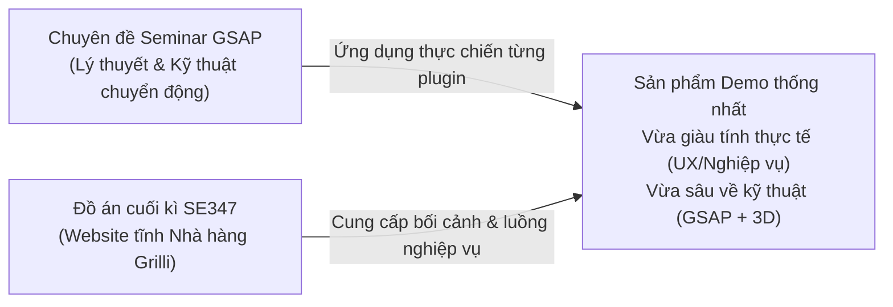
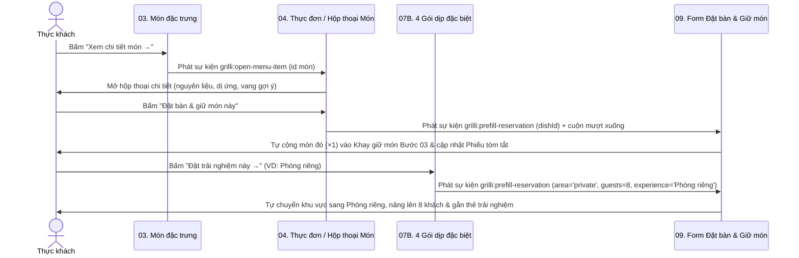
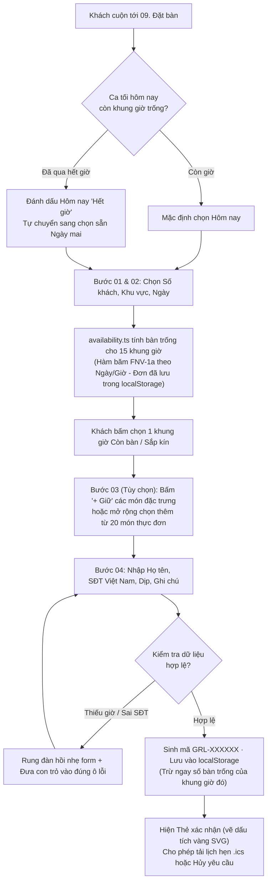

# TÀI LIỆU 01 — TỔNG QUAN WEBSITE NHÀ HÀNG TĨNH & ỨNG DỤNG SEMINAR GSAP

> **Môn học:** SE347 – Công nghệ Web và Ứng dụng  
> **Định hướng đề tài:** Xây dựng **Website Tĩnh Nhà hàng Bếp Than Hoa & Rượu Vang (Grilli)** làm Đồ án cuối kì, đồng thời tích hợp trực tiếp làm **Sản phẩm Demo sống cho chuyên đề Seminar GSAP**  
> **Mục đích tài liệu này:** Giúp toàn bộ thành viên trong nhóm nắm rõ bức tranh chung, hiểu từng công nghệ trong stack giúp ích gì, nắm chắc cấu trúc nội dung, luồng chạy (flow), các chức năng cần có và cách GSAP vận hành trên web trước khi bước sang bước **Phân công công việc (Chia việc)**.

---

## MỤC LỤC
1. [Bức tranh toàn cảnh (Big Picture) & Chiến lược "2 trong 1"](#1-bức-tranh-toàn-cảnh-big-picture--chiến-lược-2-trong-1)
2. [Tech Stack chi tiết: Dùng những gì & Từng công nghệ giúp ích gì?](#2-tech-stack-chi-tiết-dùng-những-gì--từng-công-nghệ-giúp-ích-gì)
3. [Website gồm những nội dung gì? (Kiến trúc 12 phân đoạn từ đầu đến cuối)](#3-website-gồm-những-nội-dung-gì-kiến-trúc-12-phân-đoạn-từ-đầu-đến-cuối)
4. [Flow hoạt động của Website như thế nào? (4 luồng cốt lõi)](#4-flow-hoạt-động-của-website-như-thế-nào-4-luồng-cốt-lõi)
5. [Chức năng trình bày những gì? (Checklist tính năng của Đồ án)](#5-chức-năng-trình-bày-những-gì-checklist-tính-năng-của-đồ-án)
6. [GSAP được ứng dụng vào Website như thế nào? (Trọng tâm Seminar)](#6-gsap-được-ứng-dụng-vào-website-như-thế-nào-trọng-tâm-seminar)
7. [Bảng Ma trận nối Lý thuyết Seminar GSAP ↔ Demo trên Đồ án](#7-bảng-ma-trận-nối-lý-thuyết-seminar-gsap--demo-trên-đồ-án)

---

## 1. Bức tranh toàn cảnh (Big Picture) & Chiến lược "2 trong 1"

### 1.1. Ý tưởng kết hợp Seminar GSAP vào Đồ án cuối kì
Thay vì làm 2 phần tách rời (một bộ ví dụ vuông tròn khô khan để báo cáo Seminar GSAP, rồi lại làm một website tĩnh khác để nộp Đồ án cuối kì), nhóm gộp chung thành **một sản phẩm hoàn chỉnh duy nhất**:
- **Khi báo cáo Seminar GSAP:** Nhóm trình bày lý thuyết từ cơ bản đến nâng cao của thư viện **GSAP** (*Tween, Timeline, ScrollTrigger, SplitText, Flip, quickTo, matchMedia, Ticker*). Tới mỗi khái niệm, thay vì chiếu hộp màu chạy qua lại trên CodePen, nhóm **mở thẳng từng phân đoạn tương ứng trên Website Nhà hàng Grilli** (bật bảng thông số `Alt + G`) để chứng minh kỹ thuật đó giải quyết bài toán giao diện thực tế như thế nào.
- **Khi bảo vệ Đồ án cuối kì:** Bản thân Website Nhà hàng Grilli đã là một sản phẩm Frontend tĩnh chỉn chu từ nội dung tiếng Việt, hình ảnh thật, trải nghiệm 3D đến luồng nghiệp vụ xem thực đơn – lọc món – kiểm tra bàn trống – giữ món trước – đặt bàn – xuất lịch hẹn.

### 1.2. Chân dung thương hiệu & Định hướng thẩm mỹ
- **Thương hiệu:** **Grilli — Bếp Than Hoa & Rượu Vang**, đặt tại *102 Đường số 9, phường Linh Trung, TP. Thủ Đức, TP.HCM*.
- **Câu chuyện xuyên suốt:** Khởi đầu năm 2012 từ một quán nướng nhỏ 6 bàn đầu hẻm của bếp trưởng Trần Minh Khôi. Sau 14 năm, quán phát triển thành nhà hàng hai tầng ấm cúng với tủ vang 140 nhãn nhưng vẫn giữ 3 nguyên tắc gốc: *đi chợ sáng sớm trước 7 giờ, nướng bằng than nhãn & than đước thật, và chỉ nướng mới ngay khi khách gọi*.
- **Ngôn ngữ thiết kế (Chân thực — Không mang cảm giác AI):**
  - **Màu sắc:** Lấy cảm hứng từ giao diện nhà hàng cổ điển Grilli với nền **Đen than gỗ ấm** (`#0e0d0b`, `#161310`) kết hợp sắc **Vàng Champagne** (`#e4c590`) và chữ trắng kem dịu mắt. Không dùng màu neon, không gradient tím, không chèn emoji vào giao diện.
  - **Phông chữ tiếng Việt chuẩn:** Kết hợp `Cormorant Garamond` (chữ có chân thanh lịch cho tiêu đề lớn và giá tiền) cùng `Be Vietnam Pro` (chữ không chân thiết kế riêng cho tiếng Việt, đọc cực rõ ở mô tả món ăn và nút bấm).
  - **Hình ảnh thật 100%:** Toàn bộ 52 bức ảnh món ăn, bếp lửa, quầy bar, không gian là ảnh chụp thật đã cân chỉnh đồng bộ tông màu trầm ấm và lưu trực tiếp trong dự án dưới định dạng `.webp`.

---

## 2. Tech Stack chi tiết: Dùng những gì & Từng công nghệ giúp ích gì?

Dự án là **Static Frontend (Website tĩnh chạy hoàn toàn phía trình duyệt, không cần cài đặt máy chủ Backend hay cơ sở dữ liệu riêng)** nhưng được tổ chức bằng bộ công cụ hiện đại để dễ chia việc nhóm và đạt hiệu năng cao nhất:

### 2.1. Tầng Nền tảng & Đóng gói (Core & Build)

| Công nghệ | Dùng ở đâu trong dự án? | Giúp ích gì thực sự cho nhóm & sản phẩm? |
| :--- | :--- | :--- |
| **React 19** | Toàn bộ cây giao diện (`src/components/`) | Giúp **chia nhỏ trang web dài thành các Component độc lập** (`Hero`, `Menu`, `Chef`, `Reservation`...). Mỗi bạn trong nhóm làm một file `.tsx` riêng mà **không sợ đụng code hay làm hỏng phần của bạn khác** như khi viết chung một file `index.html` dài hàng nghìn dòng. |
| **TypeScript** | Toàn bộ mã nguồn (`.ts`, `.tsx`) | Kiểm tra kiểu dữ liệu ngay lúc gõ code (ví dụ: một món ăn bắt buộc phải có `id`, `name`, `price`, `allergens`). Nếu một bạn trong nhóm gõ nhầm tên biến hay truyền thiếu dữ liệu, máy báo ngay lập tức thay vì để web chạy lên bị trắng trang. |
| **Vite 8** | Công cụ chạy thử & đóng gói (`vite.config.ts`) | Khởi động máy chủ sửa code xem ngay (Hot Reload) trong tích tắc; khi nộp bài chỉ cần gõ `npm run build` là xuất ra thư mục web tĩnh `dist/` gọn nhẹ. Đặc biệt, Vite giúp **tách riêng gói 3D (`three.js`)** để trang đầu tải siêu nhanh, khi nào cuộn xuống gần bàn rượu mới nạp 3D. |

### 2.2. Tầng Giao diện, Phông chữ & Hình ảnh (UI & Assets)

| Công nghệ | Dùng ở đâu trong dự án? | Giúp ích gì thực sự cho nhóm & sản phẩm? |
| :--- | :--- | :--- |
| **CSS thuần + Design Tokens (`CSS Variables`)** | `src/styles/tokens.css`, `base.css`, `layout.css`, `sections.css` | Mọi mã màu (`--gold-crayola`), cỡ chữ, khoảng cách đều đặt thành biến chung ở `tokens.css`. Cả nhóm cùng gọi biến này nên giao diện 12 phần đồng bộ tuyệt đối; giảng viên hỏi tới đâu cũng đọc hiểu CSS chuẩn ngay mà không bị rối bởi hàng chục class viết tắt. |
| **`@fontsource` (Tự host phông chữ)** | `Cormorant Garamond` & `Be Vietnam Pro` trong `main.tsx` | Đóng gói sẵn file phông chữ tiếng Việt `.woff2` ngay trong dự án. Không phụ thuộc mạng ngoài Google Fonts, mở offline vẫn đẹp và kết hợp với `Preloader` để **không bị hiện tượng nháy đổi phông chữ (FOUT)** lúc mới vào trang. |
| **`Sharp` + Định dạng ảnh `.webp`** | `scripts/optimize-images.mjs` & `public/images/` | Giảm dung lượng 52 bức ảnh độ phân giải cao xuống nhẹ hơn 60–75% so với PNG/JPG, đồng thời phủ nhẹ sắc ấm đồng nhất. Tự lưu trong `public/images/` giúp web **không bao giờ bị lỗi mất ảnh hay chặn ảnh (`ERR_BLOCKED_BY_ORB`)** khi thuyết trình. |

### 2.3. Tầng Chuyển động & Cuộn mượt (Trọng tâm Seminar)

| Công nghệ / Plugin | Dùng ở đâu trong dự án? | Giúp ích gì so với CSS thông thường? |
| :--- | :--- | :--- |
| **GSAP Core & `gsap.timeline()`** | Khắp toàn trang (`Hero`, `Preloader`, `MenuDetail`, `Testimonials`...) | CSS `@keyframes` rất khó nối nhiều bước phức tạp hoặc tạm dừng giữa chừng. `Timeline` của GSAP đóng vai trò như **bàn dựng phim**: đạo diễn chính xác cái gì chạy trước, cái gì chạy đè lên sau `0.15s`, dừng/chạy lại/đảo ngược chỉ bằng 1 dòng lệnh. |
| **GSAP `ScrollTrigger`** | Hầu hết các section từ `01` đến `10` | Biến hành động lăn chuột thành bộ điều khiển: cuộn tới đâu mở nội dung tới đó (`once`), neo tiến độ chuyển động dính chặt vào ngón tay lăn chuột (`scrub`), ghim đứng khung hình để kể chuyện (`pin`), gom nhóm thẻ hiện theo hàng (`batch`), và đo vận tốc lăn chuột (`getVelocity`). |
| **GSAP `SplitText`** | `Story`, `Signature`, `Menu`, `Chef`, `Experience`, `Contact` | Tự động bóc tách một câu tiếng Việt thành từng dòng (`lines`) hoặc từng từ (`words`) kèm lớp mặt nạ che (`mask: 'lines'`). Giúp chữ trồi mượt từ dưới lên hoặc sáng dần theo nhịp đọc mà **không phải cắt ghép thẻ `` thủ công trong dữ liệu** và không làm mất dấu tiếng Việt. |
| **GSAP `Flip`** | Bộ lọc Thực đơn (`Menu.tsx`) | Giải bài toán khó nhất của CSS Grid: khi bấm lọc danh mục làm ẩn bớt món, bình thường các món còn lại nhảy giật sang ô mới. `Flip` ghi nhớ vị trí cũ rồi cho các món **lướt chéo êm ái** về vị trí mới như xếp bài trên bàn. |
| **GSAP `quickTo()` & `utils`** | Nghiêng thẻ 3D (`Pillars`, `Story`, `Chef`, `Experience`), `Marquee`, `Gallery` | Khi rê chuột liên tục 60–120 lần/giây, `quickTo` tái sử dụng một bộ nội suy duy nhất để tạo cảm giác đàn hồi mượt theo tay chuột mà **không gây tốn bộ nhớ hay giật khung hình**. |
| **GSAP `matchMedia()` & `@gsap/react` (`useGSAP`)** | `src/lib/gsap.ts` & tất cả các section | `useGSAP` tự dọn sạch bộ nhớ khi đóng mở component trong React; `matchMedia()` tự phân luồng để **máy tính chạy hiệu ứng ghim/cuộn ngang hoành tráng, còn điện thoại tự chuyển sang giao diện vuốt gọn nhẹ**, đồng thời tôn trọng chế độ giảm chuyển động (`prefers-reduced-motion`). |
| **Lenis Smooth Scroll** | `src/lib/scroll.ts` | Bánh lăn chuột mặc định trên Windows thường nhảy từng khấc cứng nhắc làm giảm vẻ sang trọng của hiệu ứng `scrub`. `Lenis` làm mượt quán tính cuộn và nối trực tiếp vào `gsap.ticker` để toàn trang lướt êm như nhung. |

### 2.4. Tầng Đồ họa 3D & Nghiệp vụ Web Tĩnh (Interactive & Static Business Logic)

| Công nghệ / Kỹ thuật | Dùng ở đâu trong dự án? | Giúp ích gì thực sự cho sản phẩm? |
| :--- | :--- | :--- |
| **Three.js 0.187 (WebGL PBR)** | `src/components/three/PourScene.ts` (Mục *Trải nghiệm rót vang*) | Tạo điểm nhấn thị giác cao cấp nhất trên trang: dựng chai rượu vang thủy tinh thổi, nhãn giấy cotton dập nhũ vàng `2048px`, ly pha lê khúc xạ ánh nến và tia rượu chảy thật khi người dùng cuộn trang hoặc kéo xoay `360°`. |
| **Hàm băm `FNV-1a` + `localStorage`** | `src/lib/availability.ts` (Mục *Đặt bàn*) | Dù không có Backend, web vẫn **tính được khung giờ còn bàn / sắp kín / hết chỗ hợp lý theo từng ngày** (cuối tuần và giờ ăn tối 19h đông hơn) và **lưu đơn khách vừa đặt vào trình duyệt để trừ số bàn trống thật sự**. |
| **Tệp lịch `.ics` + `Web3Forms`** | `src/components/sections/Reservation.tsx` | Sau khi đặt bàn, khách bấm 1 nút tải ngay file `.ics` thêm lịch hẹn vào điện thoại/máy tính; nếu nhóm điền thêm khóa `Web3Forms` miễn phí, đơn đặt bàn sẽ **bắn email thật về hộp thư lễ tân**. |

---

## 3. Website gồm những nội dung gì? (Kiến trúc 12 phân đoạn từ đầu đến cuối)

Tổng thể trang web được sắp xếp theo đúng **tâm lý tự nhiên của một thực khách lần đầu tìm hiểu nhà hàng**: *Ấn tượng đầu tiên → Hiểu triết lý quán → Thèm món ngon → Xem không gian & trải nghiệm đặc biệt → Đọc đánh giá khách cũ → Quyết định đặt bàn & xem đường đi*.

### Nhóm A — Các thành phần Khung bao quanh trang (Layout Shell)
1. **Màn hình chờ (`Preloader`):** Logo Grilli, biểu tượng hình thoi xoay nhẹ và con số phần trăm `0% → 100%` trong lúc nạp phông chữ tiếng Việt và ảnh mở đầu.
2. **Thanh tiến độ đọc (`ScrollProgress`):** Sợi chỉ mảnh màu vàng champagne trên mép đỉnh màn hình, dài ra theo vị trí cuộn của người xem.
3. **Thanh thông tin phụ (`Topbar`):** Hiện gọn địa chỉ tại Linh Trung, khung giờ mở cửa hằng ngày, số điện thoại bàn và email.
4. **Thanh điều hướng chính (`Header` & Ngăn kéo Mobile):** Logo trái, 6 liên kết neo giữa (*Trang chủ, Câu chuyện, Thực đơn, Trải nghiệm, Thư viện, Liên hệ*), nút vàng **Đặt bàn** bên phải. Tự động ẩn khi cuộn xuống để nhường không gian xem ảnh và hiện lại ngay khi nhích cuộn lên; tự sáng gạch chân ở mục đang xem.
5. **Nút lên đầu trang (`BackToTop`):** Nút tròn góc phải dưới xuất hiện khi cuộn sâu xuống trang.
6. **Chân trang (`Footer`):** Bố cục 3 cột đối xứng mang đậm dấu ấn Grilli (Cột giữa là thông tin nhà hàng & form nhận bản tin ưu đãi; hai cột bên là liên kết điều hướng và mạng xã hội).
7. **Bảng đo thông số Seminar (`GsapInspector`):** Bảng nổi ẩn mặc định (chỉ mở khi nhấn tổ hợp phím `Alt + G` hoặc bấm nút nhỏ *Seminar GSAP* dưới chân trang) để phục vụ lúc nhóm đứng thuyết trình.

### Nhóm B — 12 Phân đoạn nội dung chính trong `<main>`

| Thứ tự | Tên phân đoạn | Nội dung hiển thị cụ thể trên giao diện |
| :--- | :--- | :--- |
| **01** | **Hero (Màn chào đầu)** | Trình chiếu 3 slide toàn màn hình (*Bếp than hoa giữ trọn vị nguyên bản · Nguyên liệu tươi về bếp lúc 6 giờ sáng · Hầm vang 140 nhãn chọn theo món nướng*), nút kêu gọi xem thực đơn / trải nghiệm và huy hiệu xoay *Đặt bàn* góc dưới phải. |
| **01B** | **Ba nhịp giữ lửa (`Pillars`)** | Bố cục 3 cột kiến trúc lệch tầng giới thiệu nhanh 3 nền tảng của quán: *Lửa bếp (Than nhãn & than đước)*, *Chợ sớm (Cá chẽm Vũng Tàu, tôm sú Phan Thiết, rau Củ Chi)* và *Hầm vang & Quầy bar*. |
| **02** | **Câu chuyện của Grilli (`Story`)** | Câu chuyện khởi nghiệp từ lò than nhỏ năm 2012 ở Linh Trung, câu châm ngôn làm nghề của bếp trưởng, số hotline đặt nhanh, cụm ảnh ghép 3 lớp (vỉ thịt nướng lửa hồng + tay bếp bày đĩa + con dấu tròn *Từ 2012*) và dải **4 con số thống kê** (*14 năm giữ lửa · 46 món trong thực đơn · 140 nhãn vang · 38.000+ lượt khách/năm*). |
| **03** | **Món đặc trưng (`Signature`)** | Sân khấu khám phá 4 món làm nên tên tuổi quán: *(01) Thăn bò Wagyu nướng than (890.000đ)*, *(02) Cá hồi áp chảo sốt chanh dây (420.000đ)*, *(03) Cá chẽm nướng vỉ gang sốt cà chua bi (345.000đ)*, *(04) Bánh kem phúc bồn tử & hạt dẻ cười (135.000đ)*. Kèm nguồn nguyên liệu, nhãn khẩu phần/độ chín, nút *Xem chi tiết món →* và đĩa tròn xoay bên phải. |
| **04** | **Thực đơn chính (`Menu`)** | Danh sách 20 món ăn & đồ uống chia thành 5 nhóm (*Tất cả, Khai vị, Món chính, Tráng miệng, Đồ uống*) và 4 bộ lọc đặc điểm (*Món đặc trưng, Món chay, Cay, Không gluten*). Bấm vào món bất kỳ mở hộp thoại xem sâu nguyên liệu, chất gây dị ứng và gợi ý rượu vang đi kèm. |
| **04B** | **Dải chữ chuyển động (`Marquee`)** | Dải băng chữ nghiêng chạy ngang nối giữa Thực đơn và Bếp trưởng với các cụm từ gợi cảm hứng (*Than nhãn & than đước ◊ Chợ sáng Thủ Đức 5:30 ◊ Thăn ngoại ủ khô 14 ngày ◊ Tủ vang 140 nhãn...*). |
| **05** | **Bếp trưởng (`Chef`)** | Ảnh chụp trực tiếp bếp trưởng Trần Minh Khôi bên bếp lửa khói than ca tối thứ Bảy, lời tâm sự về nghề học từ người cha bán thịt nướng ở chợ Thủ Đức, tiểu sử 18 năm đứng bếp tại Sài Gòn – Melbourne và **3 nguyên tắc bất di bất dịch (`01 – 02 – 03`)**. |
| **06** | **Thư viện ảnh (`Gallery`)** | Bộ sưu tập 16 bức ảnh thực tế chia theo 4 chủ đề (*Không gian, Món ăn, Quầy bar, Trong bếp*) trình bày trên dải băng trượt ngang nghệ thuật, bấm vào mở chế độ xem ảnh lớn toàn màn hình (`Lightbox`). |
| **07A** | **Trải nghiệm tại bàn 3D (`Experience` — Rót vang)** | Cột trái dẫn dắt 3 bước thưởng vang tại bàn kèm bộ nút chọn trực tiếp 3 dòng vang (*Vang đỏ Bordeaux 2019 · Vang hồng Provence 2022 · Vang trắng Alsace 2021*, tự đổi nhiệt độ ướp và món ăn gợi ý); cột phải là **bàn tiệc 3D thời gian thực** có chai vang, ly pha lê, nến đồng, thớt gỗ sồi và nút bần. |
| **07B** | **Dành cho dịp đặc biệt (`Experience` — 4 Gói tiệc)** | 4 thẻ dịch vụ đặt trước 24 giờ: *Bàn bếp trưởng (1.650.000đ/khách)*, *Phòng riêng 8–12 khách*, *Tối vang thứ Sáu (890.000đ/khách)* và *Đêm nhạc Acoustic cuối tuần (Không phụ thu)*. |
| **08** | **Cảm nhận thực khách (`Testimonials`)** | Trình trượt 4 câu chuyện đánh giá thực tế từ khách hàng trên Google Maps và Facebook (khen ngợi cụ thể cách bếp giảm muối cho người lớn tuổi, nhắc đặt giữ bánh phúc bồn tử sớm, trải nghiệm thử vang dễ hiểu...). |
| **09** | **Đặt bàn & Giữ món trước (`Reservation`)** | Biểu mẫu đặt bàn 4 bước rõ ràng bên trái (*01 Số khách & Khu vực · 02 Ngày dùng bữa · Khung giờ Trưa/Tối còn trống · 03 Chọn món chuẩn bị trước (không bắt buộc) · 04 Thông tin liên hệ*) đi cùng cột **Phiếu đặt bàn tóm tắt bám theo cuộn** bên phải. |
| **10** | **Liên hệ & Chỉ đường (`Contact`)** | 4 thẻ thông tin (*Địa chỉ, Giờ mở cửa kèm đèn báo trạng thái ca hiện tại, Điện thoại lễ tân/đặt tiệc, Hộp thư xuất VAT*) đặt cạnh khung bản đồ Google Maps tông than đồng có viền góc vàng và thanh dẫn đường nhanh. |

---

## 4. Flow hoạt động của Website như thế nào? (4 luồng cốt lõi)

Để cả nhóm hiểu rõ cách các phần phối hợp với nhau, dưới đây là 4 luồng vận hành từ tầng kỹ thuật lên tầng người dùng:

### Flow 1 — Luồng Khởi chạy & Đồng bộ Trục Cuộn
1. Người dùng mở trang → `App.tsx` khởi tạo `Lenis` nhưng tạm khóa cuộn (`lockScroll(true)`), hiển thị `Preloader`.
2. `Preloader` đợi tải xong 2 phông chữ tiếng Việt cùng ảnh đầu tiên và đếm tới `100%` → gọi `handleLoaded()`.
3. `App.tsx` mở khóa cuộn, kích hoạt hiệu ứng vào trang của `Hero`, đồng thời gọi `ScrollTrigger.refresh()` để tất cả các điểm ghim bên dưới đo đúng chiều cao thật của văn bản.
4. Trong suốt quá trình dùng web, một `ResizeObserver` canh chiều cao thẻ `<main>`: hễ người dùng bấm lọc thực đơn làm trang ngắn lại hoặc mở rộng khay chọn món làm trang dài ra, hệ thống tự động tính toán lại vị trí các khung ghim bên dưới để không bao giờ bị lệch tọa độ.

### Flow 2 — Luồng Tương tác Liên thông giữa các Mục (Cross-Section Flow)
Trang web sử dụng một kênh phát sự kiện gọn nhẹ (`src/lib/events.ts`) để các phân đoạn "nói chuyện" được với nhau mà không cần truyền biến lòng vòng:

### Flow 3 — Luồng Nghiệp vụ Đặt bàn thông minh trên Web Tĩnh

### Flow 4 — Luồng Hoạt cảnh 3D Rót rượu vang
- Khi khách chưa cuộn tới gần mục Trải nghiệm: trình duyệt chưa phải vẽ 3D để tiết kiệm pin.
- Khi cách mục Trải nghiệm khoảng 2 màn hình: hệ thống tải ngầm mô-đun `PourScene.ts`, dựng sẵn 3 mẫu chai vang trên bàn.
- Khi chạm đỉnh mục Trải nghiệm: màn hình ghim lại, thao tác lăn chuột điều khiển kịch bản 3 pha: **(Pha 1)** Nhấc chai từ bàn gỗ lên và nghiêng `100°` trên miệng ly → **(Pha 2)** Tia rượu tuôn ra từ cổ chai, mực rượu trong bầu ly dâng lên tới đúng 1/3 bầu kèm sóng gợn mặt thoáng (bên trái đổi sang Bước 02 giới thiệu nhiệt độ thưởng thức) → **(Pha 3)** Xoay cổ tay ngắt giọt, đặt chai thẳng đứng về bàn (bên trái chuyển sang Bước 03). Bất cứ lúc nào khách cũng có thể **bấm đổi Vang đỏ / Vang hồng / Vang trắng** hoặc **kéo chuột xoay 360°**.

---

## 5. Chức năng trình bày những gì? (Checklist tính năng của Đồ án)

Khi báo cáo đồ án môn SE347, nhóm có thể trình diễn **6 cụm chức năng thực tế** sau:

1. **Điều hướng thông minh & Thích ứng đa thiết bị:**
   - Màn hình tải trang chờ phông chữ thật; thanh tiến độ đọc; Header ẩn/hiện theo chiều cuộn và tự đánh dấu mục đang xem; Menu ngăn kéo trên điện thoại; hỗ trợ phím tắt và điều hướng bàn phím.
2. **Khám phá Món đặc trưng hai chế độ (Cuộn & Bấm):**
   - Vừa điều khiển được bằng thanh cuộn trang, vừa bấm chọn nhanh được trên thanh 4 món dưới đáy, mở trực tiếp sang hộp thoại thông tin món.
3. **Tra cứu & Lọc Thực đơn kết hợp đa điều kiện:**
   - Lọc chéo cùng lúc giữa **Danh mục** (*Khai vị, Món chính, Tráng miệng, Đồ uống*) và **Nhãn ăn kiêng/khẩu vị** (*Món chay, Cay, Không gluten, Món đặc trưng*), tự đếm lại số món khớp và có nút xóa lọc nhanh nếu giao nhau bằng 0.
   - Hộp thoại chi tiết món ăn hiển thị khẩu phần, danh sách nguyên liệu, cảnh báo dị ứng thực phẩm và gợi ý dòng vang/cocktail dùng kèm.
4. **Thư viện ảnh lọc theo không gian & Lightbox toàn màn hình:**
   - Lọc ảnh theo 4 nhóm chủ đề, phóng to ảnh sắc nét, chuyển ảnh bằng nút bấm hoặc phím mũi tên `←` `→`, đóng bằng phím `ESC`.
5. **Tương tác Bàn thử vang 3D thời gian thực:**
   - Đổi trực tiếp 3 loại vang làm thay đổi cả hình dáng vỏ chai (Bordeaux / Burgundy / Alsace), màu thủy tinh, nhãn bao bì, sắc rượu đang chảy và nội dung nhiệt độ phục vụ bên cạnh; hỗ trợ kéo chuột/chạm vuốt hoặc bấm nút `‹ ›` xoay bàn tiệc `360°`; có ảnh tĩnh dự phòng nếu máy không có WebGL.
6. **Hệ thống Đặt bàn kiểm tra chỗ trống, Giữ món trước & Xuất lịch `.ics`:**
   - Tự điều chỉnh giới hạn khách theo khu vực (ví dụ chọn *Phòng riêng* tự động nâng tối thiểu lên `6 khách`, chọn *Ban công* giới hạn tối đa `8 khách`).
   - Tự chuyển sang ngày mai khi ca tối hôm nay đã khép giờ; cập nhật số bàn còn lại ngay sau khi đặt; khay chọn giữ món trước tự tính tổng tạm tính và hiển thị trực tiếp trên **Phiếu đặt bàn bám theo cuộn**; tải file lịch `.ics` chuẩn quốc tế và hỗ trợ gửi email thật qua `Web3Forms`.

---

## 6. GSAP được ứng dụng vào Website như thế nào? (Trọng tâm Seminar)

Điểm ăn điểm lớn nhất khi chấm kết hợp Seminar + Đồ án là **nhóm không gắn hiệu ứng một cách vô tội vạ**, mà tuân thủ triết lý **"Chuyển động có chức năng (Functional & Narrative Motion)"**:

### 6.1. Dẫn dắt nhịp đọc & Kể chuyện bằng chữ (`SplitText` + `Timeline`)
- Thay vì để cả khối chữ hiện ra đột ngột, các tiêu đề lớn ở `Hero`, `Story`, `Signature`, `Menu`, `Chef`, `Experience`, `Contact` dùng `SplitText` tách từng dòng kèm mặt nạ ẩn (`mask: 'lines'`), trượt nhẹ từ dưới lên theo đường cong giảm tốc `expo.out`.
- Riêng các câu trích dẫn tâm huyết của bếp trưởng ở `Story` và `Chef` được tách theo từng từ (`words`) kết hợp `ScrollTrigger scrub`: người xem cuộn đọc tới đâu chữ sáng rõ tới đó như ánh than hồng lan dần.

### 6.2. Tạo chiều sâu không gian đa lớp (`Parallax Scrub` & `quickTo 3D Tilt`)
- Các họa tiết thảo mộc nền của Grilli (`shape-*.png`), các khung viền vàng sau lưng ảnh và 3 cột ở mục `Ba nhịp giữ lửa` trôi với tốc độ chênh lệch nhau khi cuộn (`scrub`), xóa bỏ cảm giác phẳng lì của trang web tĩnh 2D.
- Trên máy tính có chuột, `gsap.quickTo()` biến cụm ảnh `Câu chuyện`, ảnh lửa `Bếp trưởng` và 4 thẻ `Dịp đặc biệt` thành các mặt phẳng có chiều sâu 3D nghiêng nhẹ theo góc nhìn con trỏ chuột.

### 6.3. Biến thao tác cuộn dọc thành sân khấu khám phá (`Pin` + `Scrub` + `containerAnimation`)
- **Ở Món đặc trưng (`Signature`):** Ghim màn hình để người dùng tập trung vào một khung đĩa duy nhất, dùng thao tác cuộn để mở mặt nạ tròn `clipPath: circle()`, xoay đĩa và vẽ cung tiến độ SVG `strokeDashoffset`.
- **Ở Thư viện ảnh (`Gallery`):** Biến cuộn dọc thành hành trình đi dạo ngang qua 16 khung tranh; dùng `containerAnimation` (một tính năng cực kỳ đắt giá của `ScrollTrigger`) để phát hiện khi nào từng bức ảnh con trôi ngang qua màn hình và tạo hiệu ứng trượt nội bộ bên trong khung ảnh đó.

### 6.4. Phản hồi vật lý theo tốc độ người dùng (`ScrollTrigger.getVelocity()`)
- Ở dải chữ `Marquee` và các khung ảnh `Gallery`, GSAP đọc vận tốc cuộn chuột thực tế tính bằng `pixel/giây` để tăng tốc hoặc đảo chiều dải chữ và làm nghiêng nhẹ khung ảnh (`skewX`) theo quán tính, sau đó trả êm về trạng thái cân bằng bằng `gsap.delayedCall`.

### 6.5. Chuyển đổi bố cục mượt mà không giật khung (`GSAP Flip` + `ScrollTrigger.batch`)
- Ở `Thực đơn`, `ScrollTrigger.batch` giúp 20 món ăn hiện ra duyên dáng theo từng hàng khi cuộn xuống. Khi người dùng bấm lọc nhóm món, `Flip` kết hợp `absoluteOnLeave: true` và nội suy chiều cao khung lưới giúp các thẻ món lướt về chỗ mới mà phần nội dung bên dưới cũng co giãn nhịp nhàng theo, không bao giờ nhảy chồm lên đè chữ.

### 6.6. Điều khiển thế giới 3D thông qua "Biến số trung gian" (`Proxy State Pattern`)
- Thay vì viết toán học chuyển động phức tạp bên trong vòng lặp WebGL, nhóm tạo một đối tượng số thuần túy `pourState = { px, py, tilt, roll, streamHead, streamTail, fill, camZ }`. `GSAP Timeline` chỉ làm việc sở trường của nó là nội suy các con số này theo thanh cuộn, còn `Three.js` chỉ việc đọc các con số đó mỗi khung hình trên `gsap.ticker` để đặt góc nghiêng chai và mực rượu. Đây là mô hình kiến trúc chuẩn mực nhất khi kết hợp GSAP với bất kỳ thư viện vẽ Canvas/WebGL nào!

---

## 7. Bảng Ma trận nối Lý thuyết Seminar GSAP ↔ Demo trên Đồ án

Bảng này là "kim chỉ nam" để nhóm vừa phân chia phần thuyết trình lý thuyết Seminar, vừa phân chia người phụ trách code từng phân đoạn trên web:

| STT | Chủ đề Lý thuyết trong Slide Seminar GSAP | Vị trí mở Demo trực tiếp trên Web Grilli | File mã nguồn chính |
| :-: | :--- | :--- | :--- |
| **1** | Cơ bản GSAP: `to / from / fromTo`, `Timeline`, điều khiển `pause / resume`, Easing | **Preloader** & **01. Hero Slider** (thanh vạch vàng dưới đáy chính là Tween hẹn giờ) | `Preloader.tsx`, `Hero.tsx` |
| **2** | Đồng bộ Smooth Scroll (`Lenis`) với `gsap.ticker` & quản lý vòng đời React bằng `useGSAP` + `matchMedia` | Toàn trang + bật bảng **`Alt + G` (`GsapInspector`)** rồi thu nhỏ trình duyệt xuống kích thước Mobile | `lib/gsap.ts`, `lib/scroll.ts`, `GsapInspector.tsx` |
| **3** | `ScrollTrigger` cơ bản, Parallax ngược chiều & Tương tác chuột hiệu năng cao với `gsap.quickTo` | **01B. Ba nhịp giữ lửa** (cột giữa trôi ngược hai cột bìa, nghiêng thẻ 3D) | `Pillars.tsx` |
| **4** | Plugin `SplitText` (tách dòng có mặt nạ & tách từ) + Tween đối tượng số `snap` làm bộ đếm | **02. Câu chuyện** (4 con số nhảy) & **05. Bếp trưởng** (chữ sáng theo cuộn + ray thắp sáng `01–02–03`) | `Story.tsx`, `Chef.tsx` |
| **5** | `ScrollTrigger` nâng cao: Kỹ thuật Ghim màn hình (`pin + scrub`) kết hợp `clip-path` & vẽ đường SVG | **03. Món đặc trưng** (đĩa tròn mở từ tâm xoay đồng tâm + cung tròn SVG đầy dần) | `Signature.tsx` |
| **6** | Plugin `Flip` (chuyển đổi bố cục khi lọc danh sách) & `ScrollTrigger.batch` (hiện theo lô) | **04. Thực đơn 20 món** (bấm chuyển nhanh các tab danh mục và nhãn ăn kiêng) | `Menu.tsx`, `MenuDetail.tsx` |
| **7** | Đọc vận tốc cuộn `getVelocity()`, hàm tiện ích `gsap.utils` (`clamp`, `pipe`, `mapRange`) & Cuộn ngang `containerAnimation` | **04B. Dải chữ Marquee** (đảo chiều/tăng tốc) & **06. Thư viện ảnh cuộn ngang** | `Marquee.tsx`, `Gallery.tsx` |
| **8** | Mô hình Proxy Object: Kết hợp `GSAP ScrollTrigger` điều khiển cảnh 3D vật lý (`Three.js` PBR) + Phản hồi vi tương tác biểu mẫu | **07. Bàn thử vang 3D** (cuộn để rót, đổi 3 chai vang) & **09. Đặt bàn** (rung báo lỗi, vẽ tích SVG) | `Experience.tsx`, `PourScene.ts`, `Reservation.tsx` |

---

> **Bước tiếp theo cho nhóm:** Dựa trên bản đặc tả tổng thể này, nhóm có thể chia đều thành các gói công việc độc lập (ví dụ: *Nhóm Khung & Motion Core + Hero/Pillars*, *Nhóm Kể chuyện & Món đặc trưng/Thực đơn*, *Nhóm Bếp trưởng, Thư viện ngang & Đánh giá*, *Nhóm Cảnh 3D Rót vang & Hệ thống Đặt bàn/Liên hệ*) để mỗi thành viên vừa nắm 1 phần code trên web, vừa thuyết trình đúng phần kỹ thuật GSAP mình tự tay làm!
