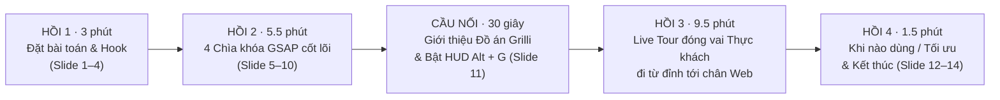

# TÀI LIỆU 02 — KỊCH BẢN & FLOW TRÌNH BÀY SEMINAR GSAP KẾT HỢP ĐỒ ÁN (TỐI ĐA 22 PHÚT)

> **Môn học:** SE347 – Công nghệ Web và Ứng dụng  
> **Thời lượng cho phép:** Tối đa **22 phút** → **Thiết kế chuẩn 20 phút 00 giây** (giữ **2 phút dự phòng an toàn** để không bao giờ bị cắt ngang hoặc lố giờ).  
> **Mục tiêu cốt lõi:** Giúp người nghe (kể cả các bạn chưa từng dùng GSAP) theo dõi cực dễ, đi một mạch mượt mà từ **Lý thuyết Seminar GSAP → Demo sống trên Đồ án Website Nhà hàng Grilli**, tối ưu điểm số theo đúng bảng **Tiêu chí đánh giá** của môn học.

---

## 1. Phân tích chiến lược ăn điểm theo Bảng Tiêu chí Đánh giá (100%)

Nhìn vào trọng số chấm điểm của giảng viên, **80% tổng điểm nằm ở Kỹ năng thuyết trình (30%) + Sản phẩm demo (30%) + Vấn đáp (20%)**:

| Tiêu chí | Trọng số | Sai lầm các nhóm hay mắc | Chiến lược ăn điểm tối đa của nhóm mình |
| :--- | :-: | :--- | :--- |
| **Slide Thuyết trình** | **5%** | Nhét đầy chữ định nghĩa và chụp nguyên màn hình code dài 40 dòng không ai đọc kịp | Chỉ dùng **13–14 Slide gọn sạch**: mỗi slide 1 sơ đồ tư duy + tối đa 5–6 dòng code trọng tâm tô sáng từ khóa |
| **Kỹ năng thuyết trình** | **30%** | Chia 2 nửa rời rạc (12 phút đọc slide lý thuyết gây buồn ngủ → 10 phút mở web lướt vội); nhảy `Alt+Tab` liên tục làm đứt mạch | Áp dụng **Cấu trúc 3 Hồi liền mạch**: *Mở màn So sánh trực quan (3p) → Giải mã 4 Chìa khóa GSAP dễ nhớ (5.5p) → Chuyến tham quan đóng vai Thực khách trực tiếp trên Web (10p) → Đúc kết (1.5p)* |
| **Làm việc nhóm** | **5%** | Người đang nói tự vừa cầm chuột gõ vừa cuộn nên bị ấp úng; lúc đổi người nói bị khựng chết sân khấu | Phối hợp nhịp **"1 Người Dẫn Chuyện + 1 Người Lái Demo"** ở phần thực chiến, có câu chuyền mic tự nhiên giữa các thành viên |
| **Tính mới, thực tiễn, sáng tạo** | **10%** | Chỉ làm ví dụ hình vuông lăn qua lại trên nền trắng hoặc web bán hàng mẫu đơn điệu | Nhấn mạnh **5 điểm sáng tạo**: ① Kỷ nguyên GSAP 3.13+ miễn phí trọn bộ plugin cao cấp (`SplitText`, `Flip`); ② Tự chế bảng đo `Alt + G` ngay trên web; ③ Đồng bộ `Lenis` ↔ `gsap.ticker`; ④ Dùng GSAP điều khiển cảnh 3D rượu vang cân bằng trọng lực; ⑤ Đặt bàn tĩnh có băm lịch trống + giữ món trước + xuất `.ics` |
| **Sản phẩm demo** | **30%** | Demo trên mạng trường chập chờn làm mất ảnh; demo rời rạc từng mảnh không ra dáng một sản phẩm hoàn chỉnh | Chạy bản đóng gói tĩnh (`npm run preview`) mượt 60fps offline 100% với 52 ảnh thật `.webp`; đi trọn vẹn từ xem món → thử vang 3D → đặt bàn trừ chỗ trống thật |
| **Vấn đáp** | **20%** | Chỉ biết gọi hàm thư viện nhưng không giải thích được bản chất bên dưới hoặc cách tối ưu máy yếu | Chủ động cài cắm sẵn các bài toán kỹ thuật đã giải quyết (chống nhảy khung `Flip`, tách lớp `transform`, tự tắt WebGL khi khuất màn hình) và chuẩn bị sẵn **Bộ 8 câu hỏi Vấn đáp tủ** ở Mục 6 |

---

## 2. Bí quyết tạo "Flow Mượt": Làm sao để người nghe dễ hiểu & không bị ngợp?

Để người nghe theo kịp từ đầu tới cuối mà không bị rối giữa "Seminar" và "Đồ án", toàn bài nói đi theo **nguyên tắc "Gieo từ khóa trước — Gặt trải nghiệm sau"**:

> **Quy tắc vàng giúp Flow mượt tuyệt đối:**  
> Nhóm **CHỈ chuyển từ Slide sang Trình duyệt ĐÚNG 1 LẦN DUY NHẤT** ở phút `08:30`!  
> - Trong `8.5 phút` đầu (Slide): Không nhồi nhét toàn bộ tài liệu GSAP. Chỉ dạy cho cả lớp **4 hình ảnh ẩn dụ cực dễ nhớ** (*Bàn dựng phim Timeline · Thước phim cuộn ScrollTrigger · Phép màu bố cục Flip & SplitText · Trạm trung chuyển 3D Proxy*).  
> - Trong `9.5 phút` tiếp theo (Trình duyệt toàn màn hình): Bật sẵn bảng đo **`Alt + G`** ở góc trái dưới. Người nghe vừa đi theo câu chuyện đi ăn tối của một vị khách tại nhà hàng **Grilli** (hiểu trọn vẹn Đồ án cuối kì), vừa thấy bảng `Alt + G` chỉ điểm chính xác **4 chìa khóa vừa học** đang vận hành sống động ở từng khu vực!

---

## 3. Phân bổ thời gian chi tiết từng phút (Tổng: 20 phút + 2 phút dự phòng)

| Mốc thời gian | Thời lượng | Phần nội dung | Màn hình hiển thị | Mục tiêu với người nghe |
| :-: | :-: | :--- | :---: | :--- |
| `00:00 – 03:00` | **3p 00s** | **Hồi 1:** Mở màn đối chiếu *Web tĩnh thường vs Web có GSAP* · GSAP là gì & Vì sao vượt trội CSS? | Slide 1 → 4 | Thu hút sự chú ý ngay 15 giây đầu; hiểu vì sao cần GSAP |
| `03:00 – 08:30` | **5p 30s** | **Hồi 2:** Giải mã 4 Chìa khóa của hệ sinh thái GSAP hiện đại | Slide 5 → 10 | Nắm gọn 4 khái niệm cốt lõi bằng hình ảnh đời thường dễ hiểu |
| `08:30 – 09:00` | **0p 30s** | **Cầu nối (Bridge):** Tổng quan kiến trúc Đồ án Nhà hàng Grilli & Bật chế độ `Alt + G` | Slide 11 → Mở Web | Hiểu bối cảnh đồ án & cách Seminar tích hợp trực tiếp vào sản phẩm |
| `09:00 – 11:00` | **2p 00s** | **Hồi 3 · Chặng 1:** Đón khách (`Preloader`, `Hero`, `Ba nhịp giữ lửa`, `Câu chuyện & Bộ đếm`) | Live Web Grilli | Thấy rõ `Timeline`, `SplitText`, `quickTo` 3D và `snap` bộ đếm |
| `11:00 – 14:00` | **3p 00s** | **Hồi 3 · Chặng 2:** Khám phá ẩm thực (`Món đặc trưng`, `Thực đơn 20 món`, `Marquee`, `Bếp trưởng`, `Thư viện ngang`) | Live Web Grilli | Trầm trồ với `Pin + Scrub`, lọc `Flip` không nhảy trang, `getVelocity` & cuộn ngang `containerAnimation` |
| `14:00 – 16:15` | **2p 15s** | **Hồi 3 · Chặng 3:** Đỉnh cao trải nghiệm (`Bàn thử vang 3D Three.js` & `4 Gói dịp đặc biệt`) | Live Web Grilli | Hiểu cách GSAP điều khiển vật thể 3D rót rượu & tương tác xoay 360° |
| `16:15 – 18:30` | **2p 15s** | **Hồi 3 · Chặng 4:** Chốt nghiệp vụ Web Tĩnh (`Đặt bàn lịch trống`, `Giữ món trước`, `Xuất .ics`, `Liên hệ & Responsive Mobile`) | Live Web Grilli | Thuyết phục hoàn toàn về chiều sâu chức năng thực tiễn của Đồ án |
| `18:30 – 20:00` | **1p 30s** | **Hồi 4:** Đúc kết *"Khi nào dùng GSAP & 3 quy tắc giữ 60fps"* · Tổng kết nhóm & Mở Vấn đáp | Slide 12 → 14 | Khép lại chuyên nghiệp, thể hiện tư duy kỹ thuật chín chắn |
| `20:00 – 22:00` | **2p 00s** | *(Khoảng đệm an toàn chống cháy giáo án / trừ hao lúc chuyển mic)* | — | Đảm bảo dừng đúng ≤ 20–21 phút, ghi điểm tuyệt đối về quản trị thời gian |

---

## 4. Kịch bản chi tiết từng Hồi (Kèm dàn ý Slide & Lời dẫn gợi ý dễ nói)

### HỒI 1 — ĐẶT VẤN ĐỀ & TỔNG QUAN GSAP (`00:00 – 03:00` · Slide 1–4)

- **Slide 1 (0:00 – 0:30) · Trang bìa kép:**
  - Tiêu đề: **Chuyên đề GSAP & Đồ án Website Nhà hàng Bếp Than Hoa Grilli**
  - Phụ đề: *Ứng dụng Nghệ thuật Chuyển động Web hiện đại nâng tầm Trải nghiệm Website Tĩnh* — Tên các thành viên nhóm.
- **Slide 2 (0:30 – 1:30) · Câu hỏi mở màn ("Nỗi đau của Web Tĩnh truyền thống"):**
  - Chiếu 2 khung GIF ngắn đặt cạnh nhau: Bên trái là trang web tĩnh bình thường (cuộn trôi tuột, bấm lọc món giật nảy khung); bên phải là trang Grilli (đĩa thức ăn xoay mở theo nhịp cuộn, lọc món lướt êm).
  - *Lời dẫn gợi ý:* *"Khi nhắc tới một Website Tĩnh không có Backend cho nhà hàng, ta thường nghĩ tới một cuốn brochure đứng im: chữ hiện sẵn, ảnh xếp hàng, bấm lọc danh mục thì giật trang. Nhưng với thực khách đi ăn Fine Dining, cảm xúc bắt đầu ngay từ lúc họ cuộn chuột trên màn hình. Làm sao đưa cảm giác ấm áp của lửa than, nhịp đặt đĩa lên bàn và nghi thức rót vang lên trình duyệt mà vẫn giữ tốc độ 60 khung hình/giây? Đó là lúc chúng ta cần tới **GSAP**."*
- **Slide 3 (1:30 – 2:15) · GSAP là gì & Cột mốc mới nhất đáng chú ý:**
  - **GSAP (GreenSock Animation Platform):** Thư viện diễn hoạt JavaScript tiêu chuẩn của ngành Web (được sử dụng trên hơn 12 triệu website và hầu hết các trang đạt giải *Awwwards Site of the Day*).
  - **Điểm cập nhật mới (ăn điểm *Tính mới*):** Trước đây các plugin mạnh nhất như `SplitText` hay `Flip` phải mua gói trả phí Club GSAP đắt đỏ; nhưng từ phiên bản **GSAP 3.13+ (sau khi Webflow mua lại và mở miễn phí 100%)**, mọi lập trình viên đều có thể sử dụng hợp pháp toàn bộ kho vũ khí này!
- **Slide 4 (2:15 – 3:00) · So sánh nhanh: Tại sao không chỉ dùng CSS `@keyframes` / `transition`?**
  - Bảng 3 dòng cực gọn:
    1. **Điều phối chuỗi phức tạp:** CSS phải tự cộng nhẩm `transition-delay` thủ công (sửa bước 1 là phải sửa lại bước 2, 3, 4); GSAP có `Timeline` tự nối đuôi thông minh.
    2. **Điều khiển theo hành vi người dùng:** CSS rất hạn chế khi muốn gắn chuyển động vào tốc độ lăn chuột, ghim màn hình hay đảo chiều giữa chừng; GSAP có `ScrollTrigger` & `quickTo`.
    3. **Diễn hoạt "Mọi con số JavaScript":** CSS chỉ sửa được thuộc tính thẻ HTML; GSAP diễn hoạt được cả **bộ đếm tiền/số liệu**, **đường vẽ SVG**, lẫn **góc nghiêng camera 3D trong Three.js**!

---

### HỒI 2 — GIẢI MÃ "4 CHÌA KHÓA" CỦA GSAP (`03:00 – 08:30` · Slide 5–10)

> *Mẹo trình bày cho người nghe dễ hiểu:* Đừng đọc danh sách thuộc tính! Mỗi chìa khóa chỉ cần **1 hình ảnh liên tưởng đời thường + 4 dòng code minh họa sạch**.

- **Slide 5 (3:00 – 4:10) · Chìa khóa 1: `Tween` & `Timeline` (Viễn cảnh "Bàn dựng phim"):**
  - **Giải thích dễ hiểu:**
    - `Tween` (`gsap.to`, `gsap.from`, `gsap.fromTo`) là **1 cảnh quay đơn lẻ**: đi từ điểm A sang điểm B với đường cong gia tốc (`ease: 'expo.out'` — phóng nhanh lúc đầu rồi đáp êm như phanh xe sang).
    - `Timeline` (`gsap.timeline()`) là **bàn dựng phim**: xếp nhiều cảnh quay nối tiếp nhau, có thể dùng tham số vị trí (`'<0.2'` = chạy sớm đè lên cảnh trước 0.2 giây) và có thể bấm `pause()`, `resume()`, `reverse()` bất cứ lúc nào.
- **Slide 6 & 7 (4:10 – 5:45) · Chìa khóa 2: `ScrollTrigger` + `Lenis` (Biến bánh lăn chuột thành tay quay phim):**
  - Giải thích 3 chế độ dùng nhiều nhất trên web thực tế:
    1. **Reveal (`once: true`):** Cuộn chạm ngưỡng nhìn (`start: 'top 80%'`) thì mở nội dung ra một lần.
    2. **Scrub (`scrub: 0.6`):** Gắn thanh thời gian dính chặt vào thanh cuộn — cuộn xuống phim chạy tới, cuộn ngược phim tua lùi!
    3. **Pin (`pin: true`):** Ghim cố định một phân đoạn giữa màn hình trong vài vòng lăn chuột để diễn trọn một hoạt cảnh (như đổi 4 đĩa món hoặc trượt dải ảnh ngang).
  - ** Sơ đồ nhỏ:** Tại sao kết hợp `Lenis` (cuộn mượt) với `gsap.ticker`? → Để cả bánh lăn chuột lẫn `ScrollTrigger` đập chung **1 đồng hồ nhịp tim duy nhất**, không bị lệch khung hình.
- **Slide 8 & 9 (5:45 – 7:20) · Chìa khóa 3: Bộ ba Plugin giải quyết bài toán khó (`SplitText`, `Flip`, `quickTo`):**
  - **`SplitText`:** Cắt tự động câu tiếng Việt thành từng dòng (`lines`) có mặt nạ che (`mask: 'lines'`) hoặc từng từ (`words`) để chữ trồi từ dưới lên mà không mất dấu mũ/dấu nặng.
  - **`Flip` (*First – Last – Invert – Play*):** Giải thích bằng 4 bước siêu dễ hiểu khi lọc danh sách món ăn: *(1) Chụp tọa độ cũ → (2) Cho DOM đổi sang lưới mới → (3) Dịch ngược thẻ về chỗ cũ → (4) Lướt êm về chỗ mới*.
  - **`gsap.quickTo()`:** Dành riêng cho sự kiện rê chuột liên tục (nghiêng thẻ 3D, hút nút từ tính) — tạo sẵn 1 đường ống cập nhật duy nhất nên rê chuột nhanh cỡ nào cũng mượt 60fps, không tốn bộ nhớ.
- **Slide 10 (7:20 – 8:30) · Chìa khóa 4: Đưa vào dự án React thực tế (`useGSAP`, `matchMedia`, `Proxy 3D`):**
  - Trong React 19: Dùng `useGSAP(..., { scope: root })` để tự dọn dẹp sạch sẽ khi đóng mở component.
  - Đa thiết bị: Dùng `gsap.matchMedia()` để máy tính chạy hiệu ứng ghim hoành tráng, còn điện thoại tự chuyển về vuốt tự nhiên không làm kẹt tay người dùng.
  - Kết nối 3D: GSAP không cần can thiệp sâu vào WebGL — chỉ cần nội suy một đối tượng số trung gian (`pourState`), còn `Three.js` đọc con số đó mỗi khung hình để vẽ!

---

### CẦU NỐI SANG ĐỒ ÁN & HÀNH TRÌNH DEMO SỐNG (`08:30 – 18:30` · Slide 11 + Live Web)

#### Bước chuyển cảnh (Phút `08:30 – 09:00` · Slide 11):
- **Slide 11:** Chiếu sơ đồ tổng quan **Đồ án cuối kì — Website Tĩnh Nhà hàng Bếp Than Hoa & Vang Grilli** (Tech stack: *React 19 + TypeScript + Vite 8 + GSAP 3.15 + Lenis + Three.js PBR*, gồm 10 phân đoạn chuẩn kiến trúc thông tin, 100% tiếng Việt & 52 ảnh chụp thật).
- **Câu nói chuyển sang Demo cực mượt:**
  > *"Để chứng minh 4 chìa khóa GSAP vừa rồi không nằm trên lý thuyết mà thực sự nâng tầm một sản phẩm Web như thế nào, nhóm đã xây dựng Đồ án cuối kì là Website Nhà hàng **Grilli** tại Linh Trung, Thủ Đức. Ngay bây giờ, mời thầy/cô và các bạn cùng đóng vai một thực khách ghé thăm website từ lúc mở trang đến lúc đặt bàn thành công — mình xin bật bảng đo **SE347 · GSAP Live Inspector (`Alt + G`)** ngay góc dưới màn hình để cả lớp theo dõi trực tiếp các thông số GSAP đang chạy ở từng mục!"*

*(Chuyển sang cửa sổ trình duyệt đã mở toàn màn hình `F11` — người dẫn chuyện nói tới đâu, bạn lái chuột thao tác nhịp nhàng tới đó)*

---

#### Chặng Demo 1: Ấn tượng đầu tiên & Câu chuyện quán (`09:00 – 11:00` · 2 phút)
1. **Tải trang (`Preloader` & `01. Hero`):**
   - Nhấn `F5` một lần (chỉ mất ~`1 giây` trên bản local): chỉ vào `Preloader` đếm `0→100%` đợi nạp xong phông tiếng Việt `Cormorant Garamond` & `Be Vietnam Pro` rồi vén màn mượt mà.
   - Tại `Hero`: chỉ vào từng dòng chữ trồi lên từ mặt nạ. **Thao tác ăn điểm:** Rê chuột vào vùng chữ giữa màn hình → chỉ cho cả lớp thấy **thanh vạch vàng dưới đáy đứng yên** (*"Thanh tiến độ này chính là một `gsap.Tween` đóng vai trò đồng hồ chuyển slide — rê chuột vào là `pause()`, đưa chuột ra là `resume()`!"*). Đưa chuột lại gần huy hiệu tròn *Đặt bàn* góc phải để thấy lực hút từ tính nhẹ (`quickTo`).
2. **Cuộn qua `01B. Ba nhịp giữ lửa` xuống `02. Câu chuyện Grilli`:**
   - Cuộn chậm qua 3 cột ảnh để lớp thấy **cột giữa trôi ngược chiều hai cột bìa** (`differential scrub`) và rê chuột nhẹ qua 1 cột để thấy ảnh nghiêng 3D + dải sáng chéo lướt qua.
   - Dừng ở `Câu chuyện`: chỉ vào câu châm ngôn của bếp trưởng sáng dần từng chữ theo nhịp cuộn (`SplitText words + scrub`), cụm 3 lớp ảnh bên phải có con dấu *Từ 2012* xoay nhanh hơn khi lăn chuột, và **4 con số thống kê cuối mục** nhảy số nguyên (`14 năm · 46 món · 140 nhãn vang · 38.000+ khách`) nhờ tween đối tượng số + `snap`.

#### Chặng Demo 2: Khám phá Món đặc trưng, Thực đơn 20 món & Thư viện ngang (`11:00 – 14:00` · 3 phút)
1. **`03. Món đặc trưng` (Ghim màn hình & Đĩa xoay đồng tâm):**
   - Lăn chuột vào mục *Bốn món làm nên tên tuổi bếp than*: khung hình tự ghim đứng lại (`pin: true`).
   - Lăn chậm qua món `01 → 02 → 03 → 04`: chỉ cho cả lớp thấy ảnh món mới mở tròn từ tâm ra (`clipPath: circle()`), xoay nhẹ như đặt đĩa mới lên bàn, đồng thời **vòng cung vàng bên ngoài tự vẽ đầy dần từ `25%` đến `100%`**. Bấm thử vào tab `01 Thăn bò Wagyu` ở thanh dưới đáy để chứng minh web không ép người dùng chỉ được cuộn mà bấm nhảy thẳng tới món vẫn mượt!
   - Bấm nút **`Xem chi tiết món →`**: hộp thoại mở lên êm ái (khóa cuộn nền), hiển thị đầy đủ khẩu phần `200g`, nguyên liệu, cảnh báo dị ứng và dòng rượu vang *Château L’Orme* gợi ý dùng kèm (tạm đóng bằng phím `ESC` để xem tiếp Thực đơn).
2. **`04. Thực đơn 20 món` (Đỉnh cao ứng dụng `GSAP Flip`):**
   - Lướt nhẹ qua danh sách để thấy từng cặp món hiện lên kèm **đường kẻ nối giá tự vẽ ngang** (`ScrollTrigger.batch`) và quầng sáng vàng dịu đi theo con trỏ chuột.
   - **Thao tác đắt giá nhất:** Bấm chuyển liên tiếp *Tất cả → Món chính → Món chay → Khai vị*! Chỉ rõ cho giảng viên và cả lớp: *"Nhờ `GSAP Flip` kết hợp `absoluteOnLeave` và nội suy chiều cao khung lưới đồng pha, các món còn lại lướt chéo về ô mới cực êm mà dòng giờ mở cửa bên dưới co giãn nhịp nhàng, không bao giờ nhảy đè lên món ăn."*
3. **`04B. Marquee` → `05. Bếp trưởng` → `06. Thư viện ảnh`:**
   - Ở dải chữ `Marquee`: lăn chuột thật nhanh xuống rồi lăn ngược lên — bảo cả lớp nhìn vào ô **`Vận tốc (getVelocity)`** trên bảng `Alt + G` để thấy dải chữ tăng tốc và đảo chiều tức thì theo quán tính tay cuộn!
   - Ở `Bếp trưởng`: cuộn chậm qua 3 nguyên tắc `01 – 02 – 03` để thấy đường ray vàng chảy tới đâu thắp sáng viên kim cương và thẻ nguyên tắc tới đó.
   - Ở `Thư viện ảnh`: cuộn dọc làm dải 16 bức ảnh trượt ngang mượt mà, đồng thời bản thân từng bức ảnh cũng trôi nhẹ bên trong khung của nó nhờ kỹ thuật `containerAnimation` và nghiêng khung nhẹ `skewX`.

#### Chặng Demo 3: Điểm nhấn Sáng tạo — Bàn thử vang 3D Three.js PBR (`14:00 – 16:15` · 2 phút 15 giây)
- Cuộn vào khu vực **`Một ly vang, rót đúng lúc`**:
  - Vừa cuộn chậm vừa thuyết minh ngắn gọn: *"Đây là nơi Chìa khóa thứ 4 — **Mô hình biến số trung gian (Proxy State)** — phát huy sức mạnh. GSAP Timeline chỉ thay đổi các con số tọa độ và góc nghiêng theo thanh cuộn, còn Three.js đọc các con số đó trên chung nhịp `gsap.ticker` để nhấc chai vang khỏi mặt bàn gỗ, nghiêng 100° rót tia rượu cong vào bầu ly pha lê khúc xạ ánh nến bập bùng phía sau."*
  - Dừng ở giữa lúc đang rót (`Bước 02`): bấm chuyển sang nút **`Vang hồng`** → chỉ ngay vào thân chai thủy tinh trong suốt: *"Mọi người để ý dù chai đang nghiêng rót, mặt thoáng rượu hồng bên trong thân chai vẫn tự cân bằng nằm ngang theo trọng lực, và bao bì nhãn giấy cotton `2048px` có chữ in mờ chống lóa kết hợp viền nhũ vàng bắt sáng rất thật!"*
  - Bấm thử sang **`Vang trắng`** (đổi sang dáng chai Alsace xanh lục bảo cổ cao, nội dung bên trái tự đổi sang *Ướp lạnh ở 8 – 10°C*), sau đó dùng chuột kéo xoay nhẹ bàn tiệc `360°` rồi cuộn nốt để chai hạ êm về mặt bàn cạnh chiếc nút bần nhuộm rượu.

#### Chặng Demo 4: Hoàn chỉnh luồng Nghiệp vụ Đồ án — Đặt bàn & Giữ món trên Web Tĩnh (`16:15 – 18:30` · 2 phút 15 giây)
1. **Tính liên thông toàn trang:** Từ 4 thẻ *Dành cho dịp đặc biệt* ngay bên dưới (rê chuột lướt nhẹ cho thấy nghiêng 3D + dải sáng chéo), bấm **`Đặt trải nghiệm này →`** ở thẻ *Bàn bếp trưởng* (hoặc *Tối vang thứ Sáu*) → trang tự cuộn êm xuống **Biểu mẫu Đặt bàn** và gắn sẵn nhãn trải nghiệm đã chọn!
2. **Nghiệp vụ Đặt bàn thông minh không cần Backend:**
   - Chỉ vào **Bước 01 & 02**: chọn ngày dùng bữa (hệ thống tự tính trạng thái *Còn bàn / Còn 2 bàn / Hết chỗ* theo giờ cao điểm bằng hàm băm ổn định), chọn một khung giờ tối `19:00` (ô giờ sáng vàng nổi bật, **Phiếu đặt bàn của bạn** bên cột phải lập tức cập nhật và trượt bám theo màn hình khi cuộn xuống!).
   - Chỉ vào **Bước 03 — Chọn món chuẩn bị trước (không bắt buộc):** bấm `+ Giữ` chọn *Thăn bò Wagyu* và *Bánh kem phúc bồn tử* (giải thích ngắn: *"Giúp bếp giữ trước các món làm mẻ nhỏ hay hết sớm trước 21 giờ mà chưa bắt khách thanh toán cọc online"* — tổng tạm tính `1.025.000đ` hiện ngay!).
   - **Bước 04:** Bấm thử nút *Gửi đặt bàn* khi chưa nhập tên/SĐT để thấy form rung đàn hồi nhẹ `elastic.out` nhắc lỗi tiếng Việt thân thiện → Điền nhanh tên + SĐT `0909 486 120` → Bấm **Gửi đặt bàn & giữ trước 2 phần**:
     - Thẻ xác nhận hiện ra với dấu tích vàng tự vẽ nét SVG, mã đặt chỗ `GRL-XXXXXX`, đầy đủ danh sách món giữ trước và nút **Lưu vào lịch (`.ics`)**!
     - *(Điểm cộng chốt hạ đồ án):* Bấm nhẹ *"Đặt thêm bàn khác"* mở lại đúng ngày giờ vừa đặt để giảng viên thấy số bàn còn lại của khung `19:00` đã **giảm đi thật sự** nhờ lưu trữ `localStorage`!
3. **Liên hệ & Thích ứng Mobile (15 giây cuối demo):** Cuộn xuống `Liên hệ` chỉ vào huy hiệu báo ca mở cửa theo giờ thực & bản đồ tông than đồng có khung góc vàng; nhấn `F12` chuyển sang khung điện thoại iPhone trong 10 giây để chứng minh `gsap.matchMedia()` tự tắt ghim màn hình, cho phép vuốt mượt không tràn ngang!

---

### HỒI 4 — ĐÚC KẾT TƯ DUY KỸ SƯ & MỞ VẤN ĐÁP (`18:30 – 20:00` · Slide 12–14)

*(Quay lại Slide trong 1 phút 30 giây cuối để kết bài đĩnh đạc)*

- **Slide 12 (18:30 – 19:15) · Khi nào NÊN & KHÔNG NÊN dùng GSAP? + 3 Quy tắc giữ 60fps:**
  - **Không lạm dụng:** Đổi màu nút bấm, hiệu ứng hover đơn giản hoặc hành động lặp đi lặp lại hàng chục lần → dùng **CSS `transition` thuần** dưới `250ms` cho nhẹ và tức thì.
  - **Dùng GSAP khi:** Cần kịch bản nhiều bước (`Timeline`), gắn chuyển động theo hành vi cuộn (`ScrollTrigger pin/scrub`), lọc danh sách phức tạp (`Flip`), tách chữ nghệ thuật (`SplitText`) hoặc điều khiển Canvas/3D.
  - **3 nguyên tắc tối ưu nhóm đã áp dụng:** ① Chỉ diễn hoạt `transform` & `opacity` (không đụng `top/left` gây tính lại bố cục); ② Tách gói `three.js` tải trễ & dùng `IntersectionObserver` ngắt vẽ 3D ngay khi cuộn khuất màn hình; ③ Luôn hỗ trợ `prefers-reduced-motion` và dọn dẹp bằng `useGSAP`.
- **Slide 13 & 14 (19:15 – 20:00) · Tổng kết đóng góp các thành viên & Lời cảm ơn / Mời Vấn đáp:**
  - Bảng đóng góp rõ ràng từng thành viên trong nhóm + mã QR (nếu nhóm đã deploy link tĩnh lên Vercel/Netlify cho cả lớp quét trải nghiệm ngay trên điện thoại — **cực kỳ ăn điểm ấn tượng với giảng viên!**).

---

## 5. Checklist "5 Phút Trước Giờ Lên Bục" (Đảm bảo Demo mượt 100% không sự cố)

1. **Chạy bằng bản Build tĩnh thay vì `npm run dev`:** Trước khi thuyết trình, gõ `npm run build` rồi `npm run preview` để mở trang đã tối ưu hóa hoàn toàn (tốc độ tải và độ mượt 3D đạt mức cao nhất, chạy 100% offline không sợ rớt Wi-Fi phòng học).
2. **Đặt độ thu phóng trình duyệt đúng `100%` (`Ctrl + 0`)** và bật chế độ toàn màn hình (`F11`) cho gọn thanh dấu trang.
3. **Xóa sạch đơn nháp cũ trước khi lên nói:** Mở DevTools → Application → Local Storage → xóa khóa `grilli:reservations` (hoặc mở cửa sổ Ẩn danh mới) để lúc demo đặt bàn số liệu sạch tinh tươm.
4. **Copy sẵn số điện thoại `0909486120` vào Clipboard (`Ctrl + V`)** để lúc demo điền form ở phút 17 chỉ mất đúng 2 giây gõ tên + dán SĐT, không mất thời gian gõ từng phím trên bục giảng.
5. **Phân vai "Song kiếm hợp bích":** Ở Hồi 3 (Demo 10 phút), nên để **1 bạn cầm chuột lái trang web thật êm** (cuộn đều tay, không giật lắc chuột loạn xạ) trong khi **bạn đang phụ trách chặng đó cầm mic thuyết minh** — trông cực kỳ chuyên nghiệp và ăn điểm *Làm việc nhóm (5%)* + *Kỹ năng thuyết trình (30%)*.

---

## 6. Bộ 8 Câu hỏi "Tủ" Phần Vấn đáp (Chiếm 20% Tổng điểm) & Gợi ý trả lời gọn sắc

1. **Câu hỏi 1: *"Hiện nay CSS hiện đại đã có `animation-timeline: scroll()`, tại sao nhóm vẫn chọn dùng GSAP ScrollTrigger?"***
   - *Trả lời:* CSS Scroll-driven Animations rất tốt cho thanh tiến độ đơn giản, nhưng chưa hỗ trợ đồng bộ trên mọi trình duyệt cũ và không thể giải quyết các bài toán phức tạp trong đồ án của nhóm như: tự động tính khoảng đệm ghim màn hình (`pin`), lồng chuyển động con bên trong dải cuộn ngang (`containerAnimation`), đọc vận tốc cuộn tức thời (`getVelocity()`) để đảo chiều chữ, lọc lưới động (`Flip`) hay nội suy biến số điều khiển `Three.js`. Vì vậy nhóm kết hợp cả hai: CSS `transition` cho hover nút nhẹ nhàng, và GSAP cho các kịch bản phức tạp.
2. **Câu hỏi 2: *"Website của nhóm là Web Tĩnh không có Backend/Database, vậy chức năng kiểm tra khung giờ trống và trừ chỗ hoạt động bằng cách nào?"***
   - *Trả lời:* Nhóm kết hợp 2 tầng trong `availability.ts`: Tầng 1 dùng hàm băm tất định `FNV-1a` trên chuỗi `ngày + giờ + khu vực` kết hợp hàm phân phối giờ cao điểm (12h trưa, 19h tối và cuối tuần đông hơn) nên cùng một ngày luôn cho ra bức tranh bàn trống nhất quán dù tải lại trang. Tầng 2 đọc danh sách đơn khách đã đặt trong `localStorage` để trừ trực tiếp số bàn còn lại. Ngoài ra form hỗ trợ tích hợp khóa `Web3Forms` để gửi email thật tới lễ tân khi đưa vào vận hành.
3. **Câu hỏi 3: *"Trang web có cả cuộn mượt, nhiều hiệu ứng GSAP lẫn cảnh 3D Three.js, nhóm làm gì để máy cấu hình yếu hoặc điện thoại không bị giật lag và nóng máy?"***
   - *Trả lời:* Nhóm áp dụng 4 lớp bảo vệ hiệu năng: ① Tách gói `three.js` tải trễ (Code-splitting) để không chặn màn hình đầu; ② Dùng `IntersectionObserver` tự động dừng hẳn vòng lặp vẽ WebGL (`gsap.ticker.remove`) ngay khi người dùng cuộn qua khỏi bàn rượu 3D; ③ Trong `PourScene.ts` có hàm `adaptQuality()` tự đo thời gian vẽ mỗi 45 khung hình, nếu thấy máy yếu bị trễ sẽ tự hạ nhẹ `pixelRatio`; ④ Dùng `gsap.matchMedia()` tắt toàn bộ `pin` trên màn hình điện thoại.
4. **Câu hỏi 4: *"Khi bấm lọc món ăn ở Thực đơn làm số lượng món thay đổi từ 20 xuống 4 món, làm sao phần chữ bên dưới không bị giật nhảy đè lên món ăn?"***
   - *Trả lời:* Nếu dùng `absolute: true` cho mọi thẻ trong `GSAP Flip`, thẻ `<ul>` sẽ mất chiều cao về `0px` ngay lập tức gây nhảy khung. Nhóm giải quyết bằng cách dùng `absoluteOnLeave: true` (chỉ tách những thẻ sắp ẩn khỏi lưới), đồng thời đo chiều cao lưới trước (`fromH`) và sau (`toH`) để dùng GSAP nội suy mượt chiều cao thẻ `<ul>` với cùng thời lượng `0.48s` và cùng hàm gia tốc `power3.out`, sau khi xong mới gọi `ScrollTrigger.refresh()`.
5. **Câu hỏi 5: *"Làm thế nào GSAP đồng bộ được với thư viện cuộn mượt Lenis và Three.js mà không bị lệch nhịp?"***
   - *Trả lời:* Nhóm tắt vòng lặp `requestAnimationFrame` tự do của cả Lenis (`autoRaf: false`) lẫn Three.js, và gắn cả hai vào chung một đồng hồ trung tâm là `gsap.ticker`, đồng thời gọi `ScrollTrigger.update` ngay trong sự kiện cuộn của Lenis và đặt `gsap.ticker.lagSmoothing(0)`.
6. **Câu hỏi 6: *"Trong React 19 (đặc biệt khi bật StrictMode render 2 lần), dùng GSAP hay gặp lỗi nhân đôi hiệu ứng hoặc rò rỉ bộ nhớ, nhóm xử lý thế nào?"***
   - *Trả lời:* Nhóm sử dụng hook chính thức `useGSAP(() => { ... }, { scope: root })` từ gói `@gsap/react` thay vì `useEffect` thuần. Khi component unmount hoặc chạy lại trong StrictMode, `gsap.context` bên dưới tự động thu hồi (`revert`) sạch sẽ mọi Tween, `SplitText` và `ScrollTrigger` đã tạo, còn các hàm bấm sự kiện được bọc qua `contextSafe()`.
7. **Câu hỏi 7: *"Phông chữ tiếng Việt có nhiều dấu mũ và dấu nặng, khi dùng `SplitText` cắt dòng có mặt nạ ẩn (`overflow: hidden`) tại sao không bị cắt mất dấu chữ?"***
   - *Trả lời:* Nhóm thay phông gốc tiếng Anh bằng cặp phông có khung dấu chuẩn tiếng Việt (`Cormorant Garamond` + `Be Vietnam Pro`), kết hợp giữ `line-height` đủ độ thoáng (`1.16 – 1.38`) và đợi `document.fonts.load(...)` hoàn tất ngay từ bước `Preloader` trước khi `SplitText` tiến hành đo và cắt dòng.
8. **Câu hỏi 8: *"Tại sao nhóm thiết kế phần Chọn món trước trong form Đặt bàn là 'Không bắt buộc' và không bắt thanh toán trước?"***
   - *Trả lời:* Vì đặc thù nhà hàng nướng than phục vụ tại bàn khác với ứng dụng giao đồ ăn: nhiều khách đặt bàn chỉ muốn chốt chỗ nhanh trong 15 giây, trong khi một số khách quen muốn dặn bếp giữ phần bánh làm mẻ nhỏ dễ hết sớm hoặc chuẩn bị than trước cho món nướng lâu. Thiết kế khay giữ món tùy chọn (liên thông từ hộp thoại chi tiết món qua `CustomEvent`) vừa giải quyết đúng nhu cầu thực tế của quán, vừa không tạo rào cản bắt buộc làm khách bỏ dở đơn đặt bàn.
