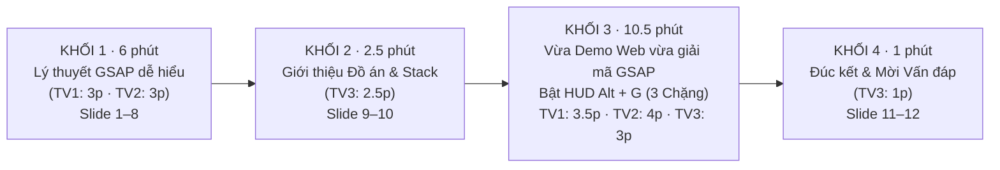

# TÀI LIỆU 03 — FLOW TRÌNH BÀY DỄ HIỂU (LÝ THUYẾT GSAP → ĐỒ ÁN → DEMO) & BẢNG CHIA VIỆC NHÓM 3 THÀNH VIÊN

> **Vai trò tài liệu:** Bản kế hoạch điều phối của **Team Leader** cho đồ án kết hợp **Seminar GSAP + Đồ án cuối kì SE347 (Website Tĩnh Nhà hàng Grilli)**.  
> **Tiêu chí số 1:** Nói cực kỳ dễ hiểu, gần gũi như kể chuyện, **tránh thuật ngữ hàn lâm**, **không lặp lời giữa Slide và Demo**, gói gọn chuẩn **20 phút** (dư 2 phút an toàn trong trần **22 phút**) và chia việc công bằng, không đụng code cho **3 thành viên**.

---

## MỤC LỤC
1. [Bức tranh Flow 20 phút (4 Khối gọn sạch, không lặp lời)](#1-bức-tranh-flow-20-phút-4-khối-gọn-sạch-không-lặp-lời)
2. [Bí kíp nói cực dễ hiểu & Bảng "Dịch" thuật ngữ sang tiếng đời thường](#2-bí-kíp-nói-cực-dễ-hiểu--bảng-dịch-thuật-ngữ-sang-tiếng-đời-thường)
3. [Chi tiết nội dung 4 Khối (Vừa Demo Web vừa giải mã GSAP tại chỗ)](#3-chi-tiết-nội-dung-4-khối-vừa-demo-web-vừa-giải-mã-gsap-tại-chỗ)
4. [Phân công công việc chi tiết cho 3 Thành viên (Code · Slide · Thuyết trình · Vấn đáp)](#4-phân-công-công-việc-chi-tiết-cho-3-thành-viên-code--slide--thuyết-trình--vấn-đáp)
5. [Quy trình phối hợp Git, Lịch tổng duyệt & Phối hợp trên bục của Team Leader](#5-quy-trình-phối-hợp-git-lịch-tổng-duyệt--phối-hợp-trên-bục-của-team-leader)

---

## 1. Bức tranh Flow 20 phút (4 Khối gọn sạch, không lặp lời)

Thay vì liệt kê hết ứng dụng GSAP trên Slide rồi xuống Web lại nói lặp lại, nhóm bỏ slide liệt kê đó và đi theo **4 Khối nối đuôi siêu mượt**:

- **Tổng thời lượng nói mỗi người cực kỳ cân bằng:**
  - **Thành viên 1 (Team Lead):** `3.0p` (Khối 1A) + `3.5p` (Demo Chặng 1) = **6.5 phút**
  - **Thành viên 2:** `3.0p` (Khối 1B) + `4.0p` (Demo Chặng 2) = **7.0 phút**
  - **Thành viên 3:** `2.5p` (Khối 2) + `3.0p` (Demo Chặng 3) + `1.0p` (Khối 4) = **6.5 phút**
  - **Tổng toàn nhóm:** **20.0 phút** (còn dư **2 phút đệm an toàn** trong giới hạn 22 phút!).

---

## 2. Bí kíp nói cực dễ hiểu & Bảng "Dịch" thuật ngữ sang tiếng đời thường

### 2.1. Ba quy tắc nói bắt buộc cho cả 3 thành viên
1. **Nói "Cảm giác mắt thấy" TRƯỚC → Gọi tên kỹ thuật SAU:**
   - ❌ *Đừng nói:* *"Nhóm dùng `ScrollTrigger` với `pin: true, scrub: 0.8` và `clipPath: circle()`."*
   - ✅ *Hãy nói:* *"Mọi người nhìn nha, khi mình lăn chuột tới đây, màn hình tự đứng lại một nhịp để đĩa đồ ăn xoay mở từ giữa ra như nhân viên vừa đặt đĩa mới lên bàn — đó là tính năng **ghim màn hình (`pin`)** của GSAP."*
2. **Dùng công thức "2 nhịp tại chỗ" trong suốt phần Demo Web:**
   - **Nhịp A (Góc nhìn Khách hàng / Đồ án):** *"Ở khu vực này khách xem được gì / bấm được gì?"*
   - **Nhịp B (Góc nhìn GSAP / Seminar):** *"Và bên dưới, GSAP làm đúng 1 việc này để cảm giác mượt như vậy..."*
3. **Trên Slide chỉ chiếu tối đa 3–4 dòng code tối giản** để chứng minh GSAP dễ đọc như tiếng Anh bình thường (VD: `gsap.to(".hop", { x: 200, duration: 1 })` → *"Lấy cái hộp, đẩy ngang 200px trong 1 giây — hết!"*).

### 2.2. Bảng "Dịch" thuật ngữ khó → Câu nói đời thường ai nghe cũng gật gù

| Thuật ngữ GSAP / Web | ❌ Tránh nói kiểu sách giáo khoa | ✅ Hãy nói kiểu đời thường cực dễ hiểu |
| :--- | :--- | :--- |
| **`Tween`** | *"Đơn vị nội suy thuộc tính theo thời gian"* | **"Làm 1 món đồ nhúc nhích"** (đi từ điểm A tới điểm B) |
| **`Ease`** | *"Hàm gia tốc phi tuyến tính Cubic-Bezier"* | **"Cảm giác phanh xe"** (phóng nhanh lúc đầu rồi đáp êm, không cứng đơ như robot) |
| **`Timeline`** | *"Container điều phối tuần tự các Tween"* | **"Ông đạo diễn / Thước phim"** — xếp nhiều thứ chạy nối đuôi, thích thì bấm dừng hoặc tua ngược cả cụm |
| **`ScrollTrigger (scrub)`** | *"Đồng bộ hóa tiến độ timeline với scrollTop"* | **"Biến bánh lăn chuột thành tay quay phim"** — lăn xuống phim chạy tới, lăn ngược phim tua lùi |
| **`ScrollTrigger (pin)`** | *"Cố định viewport tạo pin-spacer"* | **"Ghim đứng khung cảnh lại vài giây"** để kể trọn 1 cảnh đẹp rồi mới cho cuộn tiếp |
| **`SplitText`** | *"Bóc tách DOM text node kèm overflow mask"* | **"Tự cắt câu chữ thành từng dòng / từng từ"** để chữ trồi lên hoặc sáng dần theo mắt đọc mà không rớt dấu tiếng Việt |
| **`Flip`** | *"Tính toán bounding rect First-Last-Invert-Play"* | **"Phép xếp bài mượt"** — khi bấm lọc ẩn bớt món, các món còn lại tự lướt êm về chỗ mới thay vì nhảy giật cục |
| **`quickTo`** | *"Tái sử dụng instance tween tối ưu GC"* | **"Lò xo theo tay chuột"** — rê chuột tới đâu thẻ ảnh nghiêng nhẹ theo tới đó mà máy vẫn mát rượi |
| **`Lenis + gsap.ticker`** | *"Tắt autoRaf đồng bộ vòng lặp rAF"* | **"Cho cuộn mượt và hiệu ứng chạy chung 1 cái đồng hồ"** để không bị lệch nhịp hay rung màn hình |
| **`GSAP + Three.js`** | *"Nội suy Proxy state điều khiển WebGL mesh"* | **"GSAP chỉ đẩy mấy con số, còn Three.js nhìn con số đó để rót rượu"** — giống người cầm cần điều khiển từ xa |
| **`matchMedia`** | *"Phân nhánh responsive theo media query"* | **"Tự biết máy tính hay điện thoại"** — máy tính thì ghim màn hình cho đã mắt, sang điện thoại tự thả ra cho dễ vuốt |

---

## 3. Chi tiết nội dung 4 Khối (Vừa Demo Web vừa giải mã GSAP tại chỗ)

### KHỐI 1 · Lý thuyết GSAP dễ hiểu theo "Cầu thang 5 bậc" (6 phút · Slide 1–8)
*(Tham khảo lộ trình trực quan nhất của GreenSock Docs, Cassie Evans & Carl Schooff)*

- **Khối 1A — TV1 trình bày (`00:00 – 03:00` · 3 phút · Slide 1–4):**
  1. **Tại sao cần GSAP? (1p):** So sánh trực quan 15 giây giữa web tĩnh bình thường (đứng im như tờ rơi, lọc món giật khung) và web có GSAP. Nhấn mạnh: CSS chỉ hợp cho mấy việc nhỏ như đổi màu nút; muốn nhiều thứ chạy nối đuôi, cuộn chuột điều khiển hay lái 3D thì cần **GSAP** — và từ bản **GSAP 3.13+** toàn bộ công cụ xịn nhất đã **miễn phí 100%**.
  2. **`Tween` — Làm 1 thứ nhúc nhích (1p):** Nhớ đúng 3 chữ: **`to`** (đi tới đâu), **`from`** (từ đâu bay về), **`fromTo`** (chỉ rõ điểm đầu & cuối) + **`ease`** (cảm giác phanh xe êm ái).
  3. **`Timeline` — Ông đạo diễn xếp hàng (1p):** Khi 3–4 thứ cần hiện lần lượt, dùng cách cũ phải cộng nhẩm giây chờ rất khổ. `Timeline` gom vào 1 thước phim chung, tự nối đuôi và bấm dừng (`pause`) / chạy tiếp (`play`) / tua ngược (`reverse`) cả cụm cực dễ.

- **Khối 1B — TV2 trình bày (`03:00 – 06:00` · 3 phút · Slide 5–8):**
  4. **`ScrollTrigger` + `Lenis` — Biến bánh lăn chuột thành tay quay phim (1.5p):** Nhớ đúng 3 kiểu: *Chạm tới là hiện* · *Lăn tới đâu chạy tới đó (`scrub`)* · *Ghim đứng màn hình (`pin`)*. Kết hợp thêm **Lenis** chạy chung 1 đồng hồ với GSAP để bánh lăn chuột trên Windows lướt êm như nhung.
  5. **3 Trợ thủ giúp web xịn hẳn lên & Quy tắc vàng (1.5p):**
     - **`SplitText`:** Tự cắt dòng/từ tiếng Việt để chữ trồi lên hoặc sáng dần theo mắt đọc.
     - **`Flip`:** Phép xếp bài mượt khi bấm lọc danh sách.
     - **`quickTo`:** Lò xo theo tay chuột làm ảnh nghiêng 3D nhẹ nhàng.
     - *Quy tắc vàng:* Chuyển động để **dẫn mắt và tạo cảm xúc**, không làm rối mắt; tự thích ứng Máy tính / Điện thoại (`matchMedia`).

---

### KHỐI 2 · Giới thiệu Đồ án Grilli & Tech Stack đời thường (2.5 phút · Slide 9–10 · TV3)
- **Slide 9 (1p) — Đồ án có gì?**
  - Website tĩnh cho **Nhà hàng Bếp Than Hoa & Rượu Vang Grilli** tại Linh Trung, Thủ Đức (100% tiếng Việt, 52 ảnh chụp thật).
  - Khách đi trọn 1 hành trình như ngoài đời: nghe chuyện quán → khám phá 4 món đặc trưng → lọc thực đơn 20 món (xem nguyên liệu, dị ứng, gợi ý vang) → dạo thư viện 16 ảnh → thử bàn rót vang 3D → đặt bàn chọn khung giờ trống, dặn giữ món trước & tải lịch `.ics`.
- **Slide 10 (1.5p) — Tech Stack ví như xây một nhà hàng thật:**
  - **React + TypeScript + Vite *(Xây nhà lắp ghép & soát lỗi)*:** Chia web thành từng phần nhỏ để 3 thành viên làm song song không đụng nhau; có máy soát lỗi ngay lúc gõ code và đóng gói thành web tĩnh siêu nhẹ.
  - **CSS Variables + Phông tiếng Việt + Ảnh `.webp` *(Nội thất & Ánh sáng)*:** Chốt chung 1 bảng màu than gỗ ấm & vàng champagne, phông tiếng Việt tự lưu không lỗi dấu, ảnh thật lưu cục bộ không sợ rớt mạng.
  - **GSAP + Lenis *(Linh hồn chuyển động)*:** Làm mọi cú cuộn, chữ, ảnh, bộ lọc chạy chung 1 nhịp mượt mà.
  - **Three.js + `localStorage` + `.ics` *(Điểm nhấn 3D & Nghiệp vụ Web Tĩnh)*:** Dựng bàn tiệc 3D thật, và dù không có Backend vẫn trừ số bàn trống thật sau khi đặt!
- **Câu chuyển thẳng sang Trình duyệt (`F11` + bật `Alt + G`):** *"Thay vì kể khô khan trên slide, mời thầy/cô và các bạn cùng đóng vai thực khách đi một vòng quanh **Grilli** — tụi mình sẽ vừa demo tính năng vừa chỉ tận mắt GSAP đang chạy ở từng chỗ!"*

---

### KHỐI 3 · Vừa Demo Web, vừa Giải mã GSAP tại chỗ (10.5 phút · Trình duyệt toàn màn hình)

- **Chặng 1 — TV1 dẫn (`08:30 – 12:00` · 3.5 phút · `Preloader` → `Hero` → `Ba nhịp giữ lửa` → `Câu chuyện`):**
  - *Demo Đồ án:* Tải trang xem màn hình chờ, slider 3 cảnh nhà hàng, 3 trụ cột bếp than, câu chuyện 14 năm & 4 con số thống kê.
  - *GSAP tại chỗ:* Rê chuột vào chữ ở `Hero` chỉ **vạch vàng dưới đáy đứng yên** (*"Chính `Timeline.pause()` dừng đồng hồ chuyển ảnh để khách đọc thoải mái"*) + nút tròn *Đặt bàn* hút nhẹ theo chuột → Cuộn qua `Ba nhịp giữ lửa` thấy cột giữa trôi ngược hai cột bìa (`scrub`) + nghiêng 3D (`quickTo`) → Tại `Câu chuyện`, chỉ câu nói của bếp trưởng sáng dần từng chữ theo mắt đọc (`SplitText`) và 4 con số tự đếm tăng dần (`snap`).

- **Chặng 2 — TV2 dẫn (`12:00 – 16:00` · 4.0 phút · `Món đặc trưng` → `Thực đơn 20 món` → `Marquee` → `Bếp trưởng` → `Thư viện ảnh`):**
  - *Demo Đồ án:* Xem 4 món đặc trưng, bấm *Xem chi tiết món* (xem nguyên liệu, dị ứng, vang gợi ý) → Lọc chéo Thực đơn (*Nhóm món + Món chay/Cay*) → Xem 3 nguyên tắc của bếp trưởng & dạo 16 ảnh không gian (mở phóng to `Lightbox`).
  - *GSAP tại chỗ:* Ghim màn hình ở `Món đặc trưng` xoay mở đĩa tròn đồng tâm + vòng cung vàng đầy dần (`pin + scrub`) → **Điểm nhấn `Flip`:** Bấm lọc liên tiếp *Tất cả → Món chính → Món chay* để lớp thấy món lướt êm sang ô mới mà dòng chữ giờ mở cửa bên dưới co lên gọn gàng, không hề nhảy đè lên món ăn! → Lăn nhanh/ngược ở `Marquee` chỉ con số vận tốc nhảy trên bảng `Alt + G` (`getVelocity`) → Ray dọc thắp sáng lần lượt `01–02–03` ở `Bếp trưởng` → Lăn dọc trượt ngang 16 ảnh (`containerAnimation`).

- **Chặng 3 — TV3 dẫn (`16:00 – 19:00` · 3.0 phút · `Bàn thử vang 3D` → `4 Gói tiệc` → `Form Đặt bàn` → `Liên hệ & Mobile`):**
  - *Demo Đồ án:* Đổi trực tiếp 3 chai vang (*Đỏ / Hồng / Trắng*), kéo xoay bàn tiệc `360°` → Bấm *Đặt trải nghiệm này* từ thẻ dịch vụ để tự nhảy xuống **Form Đặt bàn** → Chọn giờ trống + bấm `+ Giữ` 2 món ở Bước `03` (Phiếu tóm tắt bên phải bám theo cuộn, nhảy tiền tạm tính) → Gửi đơn nhận mã `GRL-XXXXXX` + tải lịch `.ics` + mở lại ngày đó chứng minh **bàn trống giảm thật** → Xem bản đồ tông than đồng & đèn báo ca mở cửa thực tế.
  - *GSAP tại chỗ:* Giải thích cực dễ hiểu bàn 3D (*"GSAP chỉ đẩy góc nghiêng & độ cao, Three.js nhìn theo đó để nhấc chai rót rượu — khi đổi sang Vang hồng mọi người thấy mặt rượu trong chai trong suốt vẫn tự nằm ngang theo trọng lực!"*) → Thử bấm gửi lúc trống tên cho form rung báo lỗi nhẹ (`elastic`) → Thu nhỏ cửa sổ 10 giây xem giao diện điện thoại để chứng minh `matchMedia` tự tắt ghim màn hình, vuốt rất mượt.

---

### KHỐI 4 · Kết luận gọn & Mời Vấn đáp (`19:00 – 20:00` · 1 phút · Slide 11–12 · TV3)
- Chốt gọn: *Nút bấm đơn giản dùng CSS thuần cho nhẹ; kịch bản nhiều bước, cuộn ghim, lọc Flip và lái 3D thì dùng GSAP* + 3 mẹo giữ 60fps (chỉ dịch chuyển/mờ rõ, tắt vẽ 3D khi khuất tầm nhìn, tự điều chỉnh theo màn hình Mobile).
- Chiếu bảng đóng góp 3 thành viên + mã QR link web tĩnh → Cảm ơn & Mời Vấn đáp!

---

## 4. Phân công công việc chi tiết cho 3 Thành viên (Góc nhìn Team Leader)

Nguyên tắc chia việc của Team Leader: **Mỗi thành viên nhận trọn gói 1 lát cắt dọc (Code phần nào → Làm Slide lý thuyết phần đó → Lên Demo & trả lời Vấn đáp đúng phần mình làm)** để không ai bị "đọc hộ" code của người khác và không ai bị quá tải.

| Hạng mục | Thành viên 1 (Team Leader · Core & Mở màn) | Thành viên 2 (Chuyên gia Thực đơn & Chuyển động Cuộn) | Thành viên 3 (Chuyên gia 3D, Đặt bàn & Đóng gói) |
| :--- | :--- | :--- | :--- |
| **1. Phần Code phụ trách (tách file độc lập)** | • Lõi chung: `App.tsx`, `lib/gsap.ts`, `lib/scroll.ts`, `styles/tokens.css`, `base.css`, `layout.css` • Khung trang: `Preloader`, `ScrollProgress`, `Topbar`, `Header`, `Footer`, `BackToTop`, `GsapInspector` • Nội dung: **`Hero.tsx`**, **`Pillars.tsx`**, **`Story.tsx`**, `data/site.ts` | • Nội dung ẩm thực & không gian: **`Signature.tsx`**, **`Menu.tsx`**, **`MenuDetail.tsx`**, **`Marquee.tsx`**, **`Chef.tsx`**, **`Gallery.tsx`**, **`Lightbox.tsx`** • Dữ liệu: `data/menu.ts`, `data/content.ts` • Kiểm tra ảnh & nội dung khớp món 100% | • Cảnh 3D & Trải nghiệm: **`Experience.tsx`**, **`PourScene.ts`**, **`pourState.ts`** • Nghiệp vụ & Chuyển đổi: **`Testimonials.tsx`**, **`Reservation.tsx`**, `lib/availability.ts`, `lib/events.ts`, **`Contact.tsx`** • Đóng gói bản tĩnh (`npm run build`), deploy Vercel/Netlify & tạo mã QR |
| **2. Kỹ thuật GSAP "tủ" nắm chắc** | `Tween`, `Ease`, `Timeline` (`pause/resume`), `Lenis ↔ ticker`, `quickTo`, `snap` bộ đếm, `useGSAP` | `ScrollTrigger` (`once`, `scrub`, `pin`, `batch`, `getVelocity`, `containerAnimation`), `SplitText`, `Flip` (`absoluteOnLeave`) | Mô hình Proxy lái **Three.js PBR**, `matchMedia` (Desktop/Mobile/Reduced Motion), SVG stroke draw, `elastic` validate |
| **3. Slide cần thiết kế (Tổng 12 Slide)** | Slide **1–4** (Trang bìa · So sánh mở màn · Tại sao cần GSAP · `Tween` & `Timeline`) | Slide **5–8** (`ScrollTrigger` + `Lenis` · `SplitText` · `Flip` · `quickTo` & Quy tắc vàng) | Slide **9–12** (Tổng quan Đồ án Grilli · Tech Stack đời thường · Kết luận 60fps · Đóng góp nhóm & Mã QR) |
| **4. Phần Thuyết trình (~20 phút)** | **6.5 phút:** Khối 1A (`3p`) + Demo Chặng 1 (`3.5p`) | **7.0 phút:** Khối 1B (`3p`) + Demo Chặng 2 (`4p`) | **6.5 phút:** Khối 2 (`2.5p`) + Demo Chặng 3 (`3p`) + Khối 4 (`1p`) |
| **5. Nhiệm vụ phụ lúc bạn khác nói** | **Lái chuột mượt** hỗ trợ TV2 ở Chặng 2 & giữ đồng hồ bấm giờ toàn đội | Chuyển slide nhịp nhàng cho TV1 và TV3 ở Khối 1 & Khối 2 | **Lái chuột mượt** hỗ trợ TV1 ở Chặng 1 & chuẩn bị sẵn SĐT dán form ở Chặng 3 |
| **6. Trực Vấn đáp (20% điểm)** | Câu hỏi về *CSS vs GSAP*, *đồng bộ Lenis*, *vòng đời `useGSAP` trong React 19*, *tối ưu font tiếng Việt* | Câu hỏi về *lọc `Flip` không nhảy trang*, *`ScrollTrigger.batch`*, *`SplitText` không cắt dấu*, *cuộn ngang `containerAnimation`* | Câu hỏi về *GSAP lái Three.js 3D & hiệu năng máy yếu*, *đặt bàn web tĩnh `FNV-1a` + `localStorage`*, *lý do giữ món tùy chọn*, *Responsive Mobile* |

---

## 5. Quy trình phối hợp Git, Lịch tổng duyệt & Phối hợp trên bục của Team Leader

### 5.1. Quy tắc Git chống đụng code (Zero Merge Conflict)
- Nhánh `main` luôn là bản chạy ổn định. Mỗi thành viên làm trên 1 nhánh riêng:
  - TV1: `feat/tv1-core-hero-story`
  - TV2: `feat/tv2-signature-menu-gallery`
  - TV3: `feat/tv3-3d-booking-contact`
- **Quy tắc chung:** TV1 khóa xong `tokens.css`, `lib/gsap.ts`, `lib/scroll.ts` lên `main` đầu tiên để TV2 và TV3 kéo về dùng chung biến màu & cấu hình GSAP. Riêng file `sections.css`, mỗi người chỉ viết đúng trong vùng comment phân đoạn của mình (`01–02` · `03–06` · `07–10`).

### 5.2. Lộ trình 4 Mốc kiểm tra (Milestones) trước ngày báo cáo
- **Mốc 1 — Chốt khung & dữ liệu:** Xong toàn bộ giao diện tĩnh 12 phân đoạn, 52 ảnh `.webp` hiển thị đúng món, không lỗi tiếng Việt.
- **Mốc 2 — Ghép GSAP & 3D + Kiểm tra chéo:** Hợp nhất 3 nhánh về `main`; test lọc Thực đơn không nhảy khung, test đặt bàn trừ chỗ trống thật, test kéo xoay 3D & test thu nhỏ màn hình Mobile không tràn ngang.
- **Mốc 3 — Ráp 12 Slide & Bấm giờ thử (ít nhất 2 lượt):** Chạy trọn vẹn từ Slide 1 đến hết Demo Web bằng đồng hồ bấm giờ; cắt bớt lời thừa nếu tổng vượt quá `20 phút 30 giây`.
- **Mốc 4 — Checklist 5 phút trước giờ lên bục:**
  1. Chạy bản đóng gói tĩnh `npm run build` → `npm run preview` (mượt 60fps, chạy offline 100% không sợ Wi-Fi phòng học lag).
  2. Đặt zoom trình duyệt đúng `100%` (`Ctrl + 0`), bật toàn màn hình (`F11`).
  3. Mở cửa sổ Ẩn danh (hoặc xóa khóa `grilli:reservations` trong LocalStorage) để lịch bàn trống sạch đẹp trước khi demo.
  4. Copy sẵn số `0909486120` vào Clipboard (`Ctrl + V`) để điền form trong 2 giây.
  5. Áp dụng nguyên tắc **"1 người cầm mic nói – 1 người cầm chuột cuộn êm"** để mắt người nói luôn giao tiếp với giảng viên và cả lớp (ăn trọn **30% điểm Kỹ năng thuyết trình** & **5% điểm Làm việc nhóm**!).
