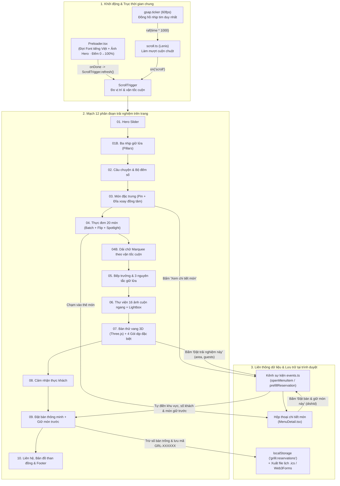
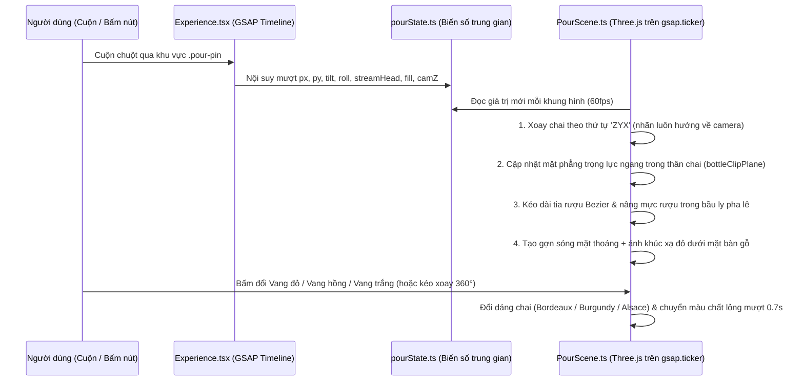

# TÀI LIỆU WORKFLOW & GIẢI PHẪU CHI TIẾT WEBSITE — NHÀ HÀNG GRILLI

> **Môn học:** SE347 – Công nghệ Web và Ứng dụng  
> **Chủ đề tích hợp:** Đồ án Website Nhà hàng Tĩnh (Static Frontend) + Demo trực tiếp cho chuyên đề **Seminar GSAP & Three.js**  
> **Thư mục dự án:** `grilli-gsap/`  
> **Ngôn ngữ hiển thị:** 100% Tiếng Việt tự nhiên

---

## Mục lục nhanh
1. [Tổng quan dự án & Triết lý thiết kế](#1-tổng-quan-dự-án--triết-lý-thiết-kế)
2. [Đúc kết từ 8 Website mẫu (Lấy tinh hoa & Né lỗi)](#2-đúc-kết-từ-8-website-mẫu-lấy-tinh-hoa--né-lỗi)
3. [Công nghệ sử dụng & Lý do lựa chọn](#3-công-nghệ-sử-dụng--lý-do-lựa-chọn)
4. [Kiến trúc tổng thể & Luồng dữ liệu toàn trang](#4-kiến-trúc-tổng-thể--luồng-dữ-liệu-toàn-trang)
5. [Cấu trúc thư mục (Muốn sửa gì thì mở file nào?)](#5-cấu-trúc-thư-mục-muốn-sửa-gì-thì-mở-file-nào)
6. [Giải thích dễ hiểu "Trái tim chuyển động" Lenis + GSAP](#6-giải-thích-dễ-hiểu-trái-tim-chuyển-động-lenis--gsap)
7. [Giải phẫu chi tiết từng phần trên Website (12 phân đoạn)](#7-giải-phẫu-chi-tiết-từng-phần-trên-website-12-phân-đoạn)
8. [Giải phẫu cảnh 3D "Rót vang tại bàn" (Three.js PBR)](#8-giải-phẫu-cảnh-3d-rót-vang-tại-bàn-threejs-pbr)
9. [Quy trình xây dựng 7 giai đoạn (Workflow từ A → Z)](#9-quy-trình-xây-dựng-7-giai-đoạn-workflow-từ-a--z)
10. [Tối ưu hiệu năng, Khả năng tiếp cận (A11y) & Kiểm thử](#10-tối-ưu-hiệu-năng-khả-năng-tiếp-cận-a11y--kiểm-thử)
11. [Hướng dẫn chạy, chỉnh sửa nhanh & Triển khai (Deploy)](#11-hướng-dẫn-chạy-chỉnh-sửa-nhanh--triển-khai-deploy)
12. [Kịch bản thuyết trình Seminar GSAP (7–10 phút)](#12-kịch-bản-thuyết-trình-seminar-gsap-710-phút)

---

## 1. Tổng quan dự án & Triết lý thiết kế

### 1.1. Bài toán & Bối cảnh thương hiệu
**Grilli** là website giới thiệu và đặt bàn cho một nhà hàng **Bếp Than Hoa & Rượu Vang** đặt tại số *102 Đường số 9, phường Linh Trung, TP. Thủ Đức* (khởi nguồn từ một quán nướng nhỏ 6 bàn năm 2012 của bếp trưởng Trần Minh Khôi, sau 14 năm phát triển thành nhà hàng 2 tầng với hầm vang 140 nhãn).

Website giải quyết đồng thời **2 mục tiêu lớn**:
1. **Về mặt sản phẩm Web (SE347):** Là một trang web tĩnh (không phụ thuộc máy chủ phức tạp, có thể đưa lên GitHub Pages, Vercel, Netlify chạy ngay), nhưng vẫn mang lại trải nghiệm hoàn chỉnh của một nhà hàng thực thụ: xem thực đơn chi tiết từng món (nguyên liệu, dị ứng, rượu vang dùng kèm), xem ảnh không gian, xoay thử bàn tiệc 3D, tra cứu **khung giờ còn bàn theo thời gian thực**, **chọn giữ món giới hạn trước** và tải phiếu hẹn lịch `.ics`.
2. **Về mặt chuyên đề Seminar GSAP:** Mỗi phân đoạn trên trang được thiết kế như một **"bài học sống"** đại diện cho một kỹ thuật trọng tâm của hệ sinh thái GSAP hiện đại (`Timeline`, `ScrollTrigger`, `SplitText`, `Flip`, `quickTo`, `matchMedia`, `ticker` đồng bộ `Lenis` và `Three.js`), kèm một bảng đo thông số thời gian thực ẩn (`Alt + G`) phục vụ lúc đứng lớp thuyết trình.

### 1.2. Năm nguyên tắc thiết kế "Chân thực — Không mang cảm giác AI"
Để giao diện nhìn giống một nhà hàng có thật ngoài đời thay vì sản phẩm tạo tự động:
1. **Giữ trọn DNA sang trọng của Grilli gốc, đồng nhất tông than gỗ ấm:** Sử dụng sắc vàng champagne (`--gold-crayola: #e4c590`) trên nền đen khói ấm (`--smoky-black-1: #0e0d0b` và hệ `--eerie-black-1..4` pha sắc nâu than `hue 32°–36°` thay vì xám xanh lạnh), giúp các cảnh nối tiếp nhau mượt mà không bị gãy màu.
2. **Không trang trí sáo rỗng:** Tuyệt đối không dùng dải màu tím neon, không lạm dụng kính mờ loè loẹt, không chèn emoji trong giao diện, không dùng con trỏ chuột giả gây vướng mắt. Mọi đường nét trang trí đều dùng viền mảnh `1px`, nút thoi xoay `45°` và hoa văn đường kỷ hà nguyên bản của Grilli.
3. **100% ảnh chụp thật tự lưu trữ (Self-hosted WebP):** Tuyển chọn 52 bức ảnh chụp thật từ Grilli gốc, Unsplash, Pexels và StockSnap; xử lý đồng bộ sắc độ trầm ấm và nén sang `.webp` bằng kịch bản `scripts/optimize-images.mjs`. Từng bức ảnh được đối chiếu bằng mắt để mô tả món ăn khớp 100% với hình (ví dụ: lát bánh bông lan hạnh nhân xen kem mascarpone, hạt dẻ cười và phúc bồn tử nguyên cuống).
4. **Cặp phông chữ hỗ trợ tiếng Việt hoàn chỉnh:** Bản Grilli tiếng Anh dùng phông *Forum* và *DM Sans* (bị lỗi rớt dấu khi gõ tiếng Việt). Dự án thay thế bằng cặp phông tự lưu trữ qua `@fontsource`:
   - **Tiêu đề & Giá tiền:** `Cormorant Garamond` (thanh mảnh, cổ điển, sang trọng đúng tinh thần *Forum*).
   - **Nội dung & Nhãn nút:** `Be Vietnam Pro` (thiết kế riêng cho tiếng Việt, dấu thanh thoáng và cực dễ đọc ở cỡ nhỏ).
5. **Câu chữ đời thường, thống nhất một nguồn dữ liệu:** Không viết lời quảng cáo sáo rỗng kiểu *"hành trình ẩm thực đỉnh cao đánh thức mọi giác quan"*, mà viết cụ thể như người làm bếp kể chuyện (*"nhóm lò từ 9 giờ sáng để than nhãn đượm hồng"*, *"cuối tuần thường hết trước 21 giờ"*). Toàn bộ địa chỉ, số điện thoại, giờ mở cửa chỉ khai báo duy nhất một nơi tại `src/data/site.ts`.

---

## 2. Đúc kết từ 8 Website mẫu (Lấy tinh hoa & Né lỗi)

Trước khi bắt tay vào code, 8 dự án nhà hàng/đồ uống tham khảo đã được chạy thử và kiểm tra kỹ để tổng hợp ưu nhược điểm:

| Website tham khảo | Điểm hay giữ lại đưa vào Grilli | Lỗi thực tế ở bản mẫu đã được khắc phục triệt để |
| :--- | :--- | :--- |
| **1. Grilli (Bản gốc)** | Bảng màu vàng champagne / đen khói, thanh Topbar, Header thông minh, Hero slider 3 cảnh, huy hiệu xoay góc phải, họa tiết `separator.svg` & `img-pattern.svg`, bố cục Đặt bàn 2 cột | Sửa lỗi mũi tên chữ V bị xoay lệch góc và bị lớp slide đè không bấm được; sửa lỗi nút lên đầu trang đè lên huy hiệu đặt bàn; sửa lỗi giờ mở cửa và SĐT mỗi chỗ ghi một kiểu |
| **2. Savoria** | Bộ lọc thực đơn theo nhóm, thư viện ảnh có lọc chủ đề + phóng to Lightbox, bố cục thẻ đánh giá 5 sao gọn gàng | Không khóa người dùng bằng màn hình chờ mỗi lần bấm nút; kiểm tra kỹ công thức tính năm (`2012 → 2026 = 14 năm`) |
| **3. Aurelia (3D Luxury)** | Ý tưởng cuộn dọc làm dải ảnh thư viện trượt ngang, bộ đếm số tăng dần khi cuộn tới | Khống chế chiều dài trang vừa đủ (không kéo dài 20.000px gây mỏi tay), bỏ con trỏ chuột giả che chữ |
| **4. Drip & Garlic** | Biến mục *Món đặc trưng* thành sân khấu ghim màn hình, cuộn tới đâu mở đĩa món ăn tới đó | Bổ sung **thanh chọn nhanh 4 món ở đáy** để người dùng vừa cuộn được vừa bấm nhảy thẳng tới món muốn xem |
| **5. Ember & Olive** | Gạch chân vàng trượt mượt giữa các tab thực đơn, gợi ý rượu vang đi kèm từng món, thanh tiến độ đọc trên đỉnh trang | Tự lưu toàn bộ ảnh trong `public/images/` để không bao giờ bị lỗi chặn ảnh `ERR_BLOCKED_BY_ORB` như khi dẫn link ngoài |
| **6. LUN-RA Hotel** | Nút đặt từ thẻ trải nghiệm / chi tiết món tự động cuộn xuống và điền sẵn lựa chọn vào biểu mẫu đặt chỗ | Cố định chiều rộng nút gửi đơn `100%` để khi hiện dòng báo lỗi màu đỏ, bố cục form không bị xô lệch |
| **7. Kemen Coffee** | Sân khấu 3D cho phép người dùng kéo chuột xoay bàn tiệc `360°`, bấm đổi loại đồ uống thì vật thể 3D đổi theo mượt mà | Tách gói `three.js` tải ngầm thông minh và dựng phòng chụp Softbox độ tương phản cao để chai & ly nổi khối rõ ràng |
| **8. Dialed Coffee** | Đồng bộ thanh cuộn trang với hành động nghiêng vật thể 3D rót chất lỏng vào ly + màn hình tải trang đếm `0 → 100%` | Khóa trục xoay địa phương `'ZYX'` để khi chai vang nghiêng rót hay đổi loại vang, nhãn bao bì mặt trước luôn hướng thẳng rõ nét về phía người xem |

---

## 3. Công nghệ sử dụng & Lý do lựa chọn

| Thành phần | Thư viện & Phiên bản | Vai trò & Lý do chọn |
| :--- | :--- | :--- |
| **Nền tảng giao diện** | `React 19` + `TypeScript 7` + `Vite 8` | Chia nhỏ từng phân đoạn rõ ràng, kiểm tra kiểu dữ liệu chặt chẽ, tốc độ biên dịch dưới `1 giây`, xuất ra gói HTML/CSS/JS tĩnh gọn nhẹ (`base: './'`) |
| **Hệ thống chuyển động** | `gsap 3.15` + `@gsap/react` (`useGSAP`) | Bộ công cụ chuẩn công nghiệp cho Web Animation; sử dụng đầy đủ `ScrollTrigger`, `SplitText`, `Flip`, `quickTo`, `matchMedia` |
| **Cuộn mượt (Smooth Scroll)** | `lenis 1.3` | Làm mượt quán tính bánh lăn chuột trên máy tính nhưng vẫn giữ nguyên cuộn cảm ứng gốc trên điện thoại và đồng bộ tuyệt đối với `gsap.ticker` |
| **Đồ họa 3D thời gian thực** | `three 0.187` (`WebGLRenderer`, `GLTFLoader`, `PMREMGenerator`) | Dựng cảnh vật lý PBR tỉ lệ thật `1 đơn vị = 1 mét` (thủy tinh thấu quang khúc xạ, chất lỏng cắt ngang theo trọng lực, bao bì dập nhũ 3 lớp `2048px`) mà không cần gánh thêm tầng trung gian nặng |
| **Định dạng & Xử lý ảnh** | `CSS Variables` thuần + `sharp` | Bám sát hệ thống biến thiết kế (`tokens.css`) của Grilli giúp dễ đọc, dễ bảo trì; `sharp` nén và cân chỉnh màu cho toàn bộ 52 ảnh `.webp` |

---

## 4. Kiến trúc tổng thể & Luồng dữ liệu toàn trang

Dù là một website tĩnh chạy hoàn toàn trên trình duyệt, các phân đoạn của Grilli không đứng rời rạc mà kết nối với nhau thành một vòng khép kín thông qua **Trục cuộn đồng bộ** và **Kênh sự kiện nội bộ (`CustomEvent`)**:



---

## 5. Cấu trúc thư mục (Muốn sửa gì thì mở file nào?)

Toàn bộ mã nguồn nằm gọn trong `c:\UIT\SE347-cnweb\grilli-gsap` với cách chia thư mục trực quan:

```text
grilli-gsap/
├── docs/
│   └── WORKFLOW.md                    # Tài liệu hướng dẫn toàn diện này
├── public/
│   ├── images/                        # 52 ảnh chụp thật (.webp) + họa tiết SVG/PNG gốc của Grilli
│   └── models/                        # Tài nguyên 3D CC0 (chân nến đồng, thớt gỗ sồi, vân thủy tinh)
├── scripts/
│   └── optimize-images.mjs            # Script tự động chỉnh tông màu ấm & nén ảnh sang WebP bằng sharp
├── src/
│   ├── data/                          # NƠI CHỨA TOÀN BỘ NỘI DUNG CHỮ & GIÁ TIỀN (dễ sửa nhất!)
│   │   ├── site.ts                    # Tên quán, địa chỉ, SĐT, giờ mở cửa, link bản đồ, 3 slide mở đầu
│   │   ├── content.ts                 # Nội dung Câu chuyện, 4 Món đặc trưng, Bếp trưởng, 16 ảnh Thư viện, 4 Gói tiệc, Đánh giá
│   │   └── menu.ts                    # Danh sách 20 món ăn/đồ uống, giá, nguyên liệu, dị ứng, gợi ý vang
│   ├── lib/                           # CÁC BỘ XỬ LÝ LÕI DÙNG CHUNG
│   │   ├── gsap.ts                    # Đăng ký Plugin GSAP 1 lần duy nhất + cấu hình matchMedia (MQ)
│   │   ├── scroll.ts                  # Khởi tạo cuộn mượt Lenis nối vào gsap.ticker + hàm khóa cuộn / cuộn tới mục
│   │   ├── availability.ts            # Thuật toán tính lịch trống theo ngày/giờ + lưu đơn vào localStorage
│   │   └── events.ts                  # Kênh phát tín hiệu mở chi tiết món & điền sẵn form đặt bàn
│   ├── components/
│   │   ├── layout/                    # Khung bao quanh trang
│   │   │   ├── Preloader.tsx          # Màn hình chờ đếm 0–100% khi mới vào trang
│   │   │   ├── ScrollProgress.tsx     # Thanh chỉ vàng mảnh chạy dọc mép trên màn hình
│   │   │   ├── Topbar.tsx             # Thanh thông tin địa chỉ, giờ mở cửa, điện thoại trên cùng
│   │   │   ├── Header.tsx             # Thanh điều hướng chính + Menu ngăn kéo trên điện thoại
│   │   │   ├── Footer.tsx             # Chân trang 3 cột đối xứng + đăng ký nhận bản tin
│   │   │   ├── BackToTop.tsx          # Nút tròn quay lại đầu trang góc phải dưới
│   │   │   └── GsapInspector.tsx      # Bảng đo thông số trực tiếp cho buổi Seminar (bật bằng Alt + G)
│   │   ├── sections/                  # 10 PHÂN ĐOẠN NỘI DUNG CHÍNH CỦA TRANG WEB
│   │   │   ├── Hero.tsx               # 01. Banner trượt 3 cảnh mở đầu
│   │   │   ├── Pillars.tsx            # 01B. Ba nhịp giữ lửa (3 cột kiến trúc Grilli)
│   │   │   ├── Story.tsx              # 02. Câu chuyện nhà hàng + Cụm ảnh 3 lớp + 4 con số nhảy
│   │   │   ├── Signature.tsx          # 03. Sân khấu ghim 4 Món đặc trưng + Đĩa tròn xoay đồng tâm
│   │   │   ├── Menu.tsx               # 04. Thực đơn 20 món lọc mượt với GSAP Flip
│   │   │   ├── Chef.tsx               # 05. Bếp trưởng Trần Minh Khôi & 3 nguyên tắc giữ lửa
│   │   │   ├── Gallery.tsx            # 06. Thư viện ảnh cuộn ngang + lọc chủ đề
│   │   │   ├── Experience.tsx         # 07. Khu vực ghim rót vang 3D + 4 thẻ Trải nghiệm dịp đặc biệt
│   │   │   ├── Testimonials.tsx       # 08. Trình trượt đánh giá của thực khách
│   │   │   ├── Reservation.tsx        # 09. Biểu mẫu Đặt bàn + Lịch trống + Chọn giữ món trước
│   │   │   └── Contact.tsx            # 10. Thông tin liên hệ, trạng thái ca mở cửa & Bản đồ
│   │   ├── three/                     # ĐỒ HỌA 3D RÓT RƯỢU VANG (Tách gói tải riêng)
│   │   │   ├── pourState.ts           # Các con số trạng thái trung gian (góc nghiêng, mực rượu, camera...)
│   │   │   └── PourScene.ts           # Toàn bộ thế giới 3D Three.js (chai vang, nhãn 2048px, ly pha lê, nến)
│   │   ├── ui/                        # Các thành phần giao diện tái sử dụng
│   │   │   ├── Button.tsx             # Nút bấm 2 lớp chữ trượt kiểu Grilli
│   │   │   ├── SectionHead.tsx        # Cụm tiêu đề phụ + hoa văn separator + tiêu đề lớn
│   │   │   ├── MenuDetail.tsx         # Hộp thoại xem chi tiết món ăn & gợi ý rượu vang
│   │   │   ├── Lightbox.tsx           # Hộp thoại phóng to ảnh thư viện toàn màn hình
│   │   │   └── Icons.tsx              # Bộ biểu tượng SVG nét mảnh đồng bộ
│   │   └── Marquee.tsx                # 04B. Dải chữ chạy ngang phản hồi theo tốc độ lăn chuột
│   ├── styles/                        # HỆ THỐNG GIAO DIỆN CSS
│   │   ├── tokens.css                 # Biến màu sắc, phông chữ, cỡ chữ, khoảng cách, đổ bóng
│   │   ├── base.css                   # Reset mặc định, khung container, lưới dùng chung, nút bấm
│   │   ├── layout.css                 # Giao diện Preloader, Header, Topbar, Footer, bảng HUD Seminar
│   │   └── sections.css               # Giao diện chi tiết cho từng phân đoạn từ 01 đến 10
│   ├── App.tsx                        # Ghép nối toàn bộ trang & tự làm mới ScrollTrigger khi đổi chiều cao
│   └── main.tsx                       # Điểm khởi chạy ứng dụng React & nạp phông chữ tiếng Việt
├── index.html                         # Thẻ SEO tiếng Việt, OpenGraph & dữ liệu có cấu trúc JSON-LD Restaurant
├── package.json                       # Danh sách thư viện và câu lệnh chạy
└── vite.config.ts                     # Cấu hình đóng gói chia nhỏ file (tách riêng gói motion & three)
```

---

## 6. Giải thích dễ hiểu "Trái tim chuyển động" Lenis + GSAP

Nếu bạn mới tiếp xúc với GSAP hoặc cần giải thích cho giảng viên và các bạn trong lớp nghe dễ hiểu nhất, hãy hình dung hệ thống chuyển động của web qua **5 cơ chế cốt lõi** sau:

### 6.1. Đồng hồ nhịp tim chung: `Lenis` bắt tay với `gsap.ticker` (`src/lib/scroll.ts`)
- **Vấn đề thường gặp:** Khi dùng thư viện cuộn mượt bên ngoài cùng với `ScrollTrigger`, nếu mỗi thư viện tự chạy một vòng lặp thời gian riêng (`requestAnimationFrame`), trang web rất dễ bị rung giật ở các đoạn ghim màn hình (`pin: true`) vì hai bên cập nhật tọa độ lệch nhịp nhau vài mili-giây.
- **Cách giải quyết trong web:** Tắt vòng lặp riêng của Lenis (`autoRaf: false`) và cắm thẳng Lenis vào đồng hồ của GSAP (`gsap.ticker.add((time) => lenis.raf(time * 1000))`). Mỗi khi Lenis nhích tọa độ cuộn, nó báo ngay cho `ScrollTrigger.update`, đồng thời tắt `gsap.ticker.lagSmoothing(0)`. Nhờ vậy, **cuộn mượt, chữ chạy và cảnh 3D đều đập chung một nhịp đồng hồ 60 khung hình/giây**.

### 6.2. Quản lý vòng đời sạch sẽ trong React: `useGSAP()` & `contextSafe`
- Thay vì dùng `useEffect` dễ quên hủy hiệu ứng (gây lỗi nhân đôi khoảng trắng ghim màn hình trong React StrictMode), mọi phân đoạn đều dùng hook chính chủ `useGSAP(() => { ... }, { scope: root })`.
- Khi component đóng lại hoặc đổi bộ lọc, `useGSAP` tự động thu hồi (revert) toàn bộ thẻ DOM, chữ đã tách (`SplitText`) và các mốc `ScrollTrigger` bên trong phạm vi `root`. Các hàm xử lý sự kiện bấm chuột (như chuyển slide, bấm lọc món) được bọc trong `contextSafe(...)` để cũng được tự động dọn dẹp an toàn.

### 6.3. Thích ứng thông minh theo thiết bị: `gsap.matchMedia()` (`src/lib/gsap.ts`)
Không ép điện thoại màn hình nhỏ phải chạy các hiệu ứng ghim màn hình phức tạp của máy tính:
- `MQ.desktop` (`>= 992px` và không bật giảm chuyển động): Bật đầy đủ ghim màn hình *Món đặc trưng*, cuộn ngang *Thư viện*, cuộn rót rượu 3D và nghiêng thẻ 3D theo chuột.
- `MQ.mobile` (`<= 991px`): Tự động chuyển *Món đặc trưng* thành bấm chọn trực tiếp, *Thư viện* thành dải ảnh vuốt ngang tự nhiên bằng ngón tay, và cảnh 3D tự chạy kịch bản rót mượt khi lướt tới mà không khóa cứng màn hình.
- `MQ.reduced` (`prefers-reduced-motion: reduce`): Dành cho người dùng nhạy cảm tiền đình — bỏ qua chuyển động bay nhảy, hiển thị ngay con số cuối cùng và ly vang đã rót sẵn.

### 6.4. Năm "vũ khí" hiệu ứng GSAP được phối hợp trên trang
1. **`gsap.timeline()` (Kịch bản đạo diễn):** Sắp xếp nhiều chuyển động nối tiếp hoặc chồng lên nhau theo mốc thời gian chính xác (ví dụ: màn vén mở ra → ảnh thu phóng nhẹ về `1.0` → tiêu đề trồi lên → nút bấm hiện ra sau `0.2s`).
2. **`ScrollTrigger` (Biến thanh cuộn thành tay cầm điều khiển):**
   - `once: true`: Chạm tới vùng nhìn là chạy hiệu ứng xuất hiện một lần gọn gàng.
   - `scrub: 0.6`: Neo chặt tiến độ hiệu ứng vào ngón tay lăn chuột (lăn xuống chạy tới, lăn ngược tua lại mượt mà với độ trễ nhung `0.6s`).
   - `pin: true`: Giữ cố định khung hình ở giữa màn hình trong lúc người dùng cuộn để kể trọn vẹn một câu chuyện (đổi 4 đĩa món đặc trưng, trượt ngang 16 bức ảnh, hoặc rót đầy ly vang 3D).
   - `ScrollTrigger.batch()`: Gom các thẻ món ăn cùng lọt vào màn hình trong `0.08s` thành từng cặp để hiện ra nhịp nhàng từ trên xuống dưới.
3. **`SplitText` (Nghệ thuật chữ chuyển động):** Tự động tách câu văn tiếng Việt thành từng dòng (`lines`) có lớp mặt nạ che (`mask: 'lines'`) để chữ trồi từ dưới vạch vô hình lên mà không bị cắt mất dấu mũ/dấu nặng tiếng Việt, hoặc tách thành từng từ (`words`) để thắp sáng câu trích dẫn theo đúng tốc độ mắt đọc.
4. **`Flip` — First, Last, Invert, Play (Phép màu lọc danh sách không giật):** Khi bấm lọc *Món chính*, trình duyệt vốn đổi bố cục cái bụp. `Flip` chụp lại tọa độ cũ (*First*), cho React ẩn/hiện món sang vị trí mới (*Last*), tính khoảng lệch để đặt ngược về chỗ cũ (*Invert*), rồi lướt mượt tới chỗ mới (*Play*).
5. **`gsap.quickTo()` (Lò xo phản hồi chuột siêu nhẹ):** Nếu gọi `gsap.to()` liên tục hàng trăm lần mỗi giây trong sự kiện `pointermove`, trình duyệt sẽ phải cấp phát bộ nhớ liên tục gây khựng. `quickTo` tạo sẵn một đường ống tính toán duy nhất để nghiêng thẻ 3D, hút nút bấm và đổi tốc độ chữ chạy ở mức chi phí gần bằng `0`.

---

## 7. Giải phẫu chi tiết từng phần trên Website (12 phân đoạn)

Dưới đây là cách hoạt động cụ thể của từng phần theo đúng thứ tự từ trên xuống dưới khi mở trang:

### Khung bao ngoài (Layout Shell)
- **`Preloader.tsx`:** Khi mới vào trang, thanh cuộn tạm khóa (`lockScroll(true)`). Preloader chủ động gọi `document.fonts.load(...)` nạp đúng 2 phông `Cormorant Garamond` và `Be Vietnam Pro` cùng ảnh nền đầu tiên trong khi chạy con số `0% → 100%`. Ngay khi tải xong, màn đen vén lên trên và gọi `ScrollTrigger.refresh()` để mọi phép đo chiều cao bên dưới chính xác tuyệt đối.
- **`ScrollProgress.tsx`:** Thanh chỉ mảnh màu vàng trên mép đỉnh màn hình, phóng ngang `scaleX: 0 → 1` theo toàn bộ chiều dài trang.
- **`Topbar.tsx` & `Header.tsx`:** Khi cuộn xuống quá `80px`, thanh Header thu gọn nền đen mờ; nếu tiếp tục cuộn xuống thì ẩn nhẹ lên trên để nhường chỗ xem ảnh, nhưng chỉ cần nhích cuộn ngược lên là hiện lại ngay. Các mục trên thanh điều hướng tự động sáng gạch chân vàng theo đúng phân đoạn đang xem.
- **`GsapInspector.tsx` (`Alt + G`):** Bảng thông số nổi góc dưới trái (mặc định ẩn hoàn toàn để khách nhà hàng không thấy, chỉ bật khi nhấn `Alt + G` hoặc bấm nút *Seminar GSAP* dưới chân trang). Hiển thị trực tiếp `% tiến độ cuộn`, `vận tốc cuộn (px/s)`, `tổng số ScrollTrigger đang hoạt động` và `tên kỹ thuật GSAP của phân đoạn hiện tại`.

---

### Phân đoạn 01 · Banner mở đầu (`Hero.tsx`)
- **Trải nghiệm:** Trình chiếu 3 khung cảnh chủ đạo (Bếp lửa than hồng · Nguyên liệu chợ sớm · Hầm vang 140 nhãn) tự động chuyển sau mỗi `7 giây`.
- **Cơ chế hoạt động:**
  - Mỗi lần chuyển cảnh tạo một `gsap.timeline()` mới: ẩn chữ cũ bay nhẹ lên trên, hòa mờ (`crossfade`) sang ảnh nền mới đang thu phóng rất chậm (`scale: 1.12 → 1.0`), rồi đẩy từng dòng tiêu đề mới từ sau mặt nạ chữ lên (`yPercent: 110 → 0`).
  - **Chi tiết tinh tế:** Thanh vạch vàng chạy ngang dưới chân Hero **chính là bộ đếm thời gian (`timer.current`)** chuyển slide! Rê chuột vào vùng chữ sẽ gọi `timer.pause()` làm thanh vàng đứng yên để bạn đọc thoải mái; rời chuột ra thanh vàng chạy tiếp. Khi cuộn qua khỏi Hero, `ScrollTrigger` tự động tạm dừng slider để tiết kiệm CPU.
  - Rê chuột trên màn hình máy tính làm tấm ảnh nền trôi nhẹ ngược hướng chuột (`gsap.quickTo`), và huy hiệu tròn *Đặt bàn* góc phải dưới có lực hút từ tính nhẹ về phía đầu con trỏ.

### Phân đoạn 01B · Ba nhịp giữ lửa (`Pillars.tsx`)
- **Trải nghiệm:** 3 cột giới thiệu 3 trụ cột cốt lõi của quán (*Lửa bếp · Chợ sớm · Hầm vang & Quầy bar*), cột giữa đặt thấp hơn hai cột bìa tạo nhịp điệu kiến trúc đặc trưng của Grilli.
- **Cơ chế hoạt động:**
  - Khi cuộn tới: 3 khung ảnh mở màn từ dưới lên (`clipPath: inset(100% 0 0 0) → inset(0)`), dải hoa văn vàng `img-pattern.svg` giãn dọc phía sau.
  - **Trôi ngược chiều (`Differential Column Scrub`):** Khi lăn chuột đi qua, hai cột ngoài trôi nhẹ lên (`-24px`) trong khi cột giữa trôi nhẹ xuống (`+28px`), tạo chiều sâu thị giác rất tự nhiên.
  - Rê chuột vào từng thẻ sẽ nghiêng khung ảnh trong không gian 3D (`rotationX`, `rotationY` bằng `quickTo`), lật dải hoa văn vàng `180°` và quét một dải sáng chéo qua mặt ảnh (`.has-shine`).

### Phân đoạn 02 · Câu chuyện Grilli & Bộ đếm số (`Story.tsx`)
- **Trải nghiệm:** Kể lại hành trình 14 năm từ quán nướng 6 bàn ở đầu hẻm Linh Trung, kèm cụm ảnh ghép 3 lớp (ảnh vỉ than rực lửa + ảnh bếp bày đĩa + con dấu tròn *Từ 2012*) và 4 con số thống kê cuối mục.
- **Cơ chế hoạt động & Cách xử lý không xung đột:**
  - **Hiệu ứng chữ:** Tiêu đề và 2 đoạn văn dùng `SplitText` (`type: 'lines', mask: 'lines'`) mở mượt từng dòng. Phần trích dẫn của bếp trưởng có vạch vàng bên trái vẽ dọc từ trên xuống (`scaleY: 0 → 1`) trong khi từng từ sáng dần lên (`opacity: 0.24 → 1`) theo nhịp cuộn đọc của người xem.
  - **Tách lớp Wrapper tránh xung đột `transform`:** Nếu vừa dùng GSAP diễn hoạt ảnh bay vào (`y`), vừa dùng `ScrollTrigger scrub` kéo parallax (`y`), lại vừa nghiêng chuột 3D trên cùng một thẻ HTML, các lệnh sẽ giẫm chân lên nhau gây giật. Ở `Story.tsx`, mỗi nhiệm vụ được giao cho một lớp vỏ bọc riêng: `.story-main` mở `clipPath` + màn vén vàng `.story-curtain` → `.story-main-parallax` chịu trách nhiệm trôi dọc khi cuộn → `.story-main-tilt` chịu trách nhiệm nghiêng 3D theo chuột! Tương tự, con dấu `2012` quay đều vô tận ở thẻ trong và tăng tốc xoay theo cuộn ở thẻ vỏ ngoài.
  - **Bộ đếm số nguyên (`Snap Counter`):** GSAP không sửa trực tiếp chữ HTML mà tăng dần giá trị một biến số `obj = { v: 0 }` lên tới đích (`14`, `46`, `140`, `38.000+`), làm tròn đến hàng đơn vị (`snap: { v: 1 }`) rồi định dạng dấu chấm phân cách hàng nghìn tiếng Việt (`toLocaleString('vi-VN')`).

### Phân đoạn 03 · Bốn Món đặc trưng (`Signature.tsx`)
- **Trải nghiệm:** Khung hình ghim lại giữa màn hình; khi lăn chuột, đĩa thức ăn tròn bên phải mở rộng từ tâm ra xoay nhẹ như người phục vụ đặt đĩa mới lên bàn, đồng thời cung tròn vàng bên ngoài đầy dần từ `25% → 50% → 75% → 100%`. Người dùng cũng có thể bấm trực tiếp vào 4 tên món ở thanh ngang dưới đáy để nhảy tới món bất kỳ.
- **Điểm đắt giá về bố cục & hình học:**
  1. **Đồng tâm tuyệt đối `0.0px`:** Cả vòng cung tiến độ SVG (`.sig-progress-svg`), vòng xoay 4 viên kim cương (`.sig-ring`) và chồng 4 bức ảnh tròn (`.sig-media-stack` lùi vào `9.2%`) đều đặt chung trong **một khung vuông duy nhất `.sig-plate-box` (`aspect-ratio: 1`)**. Nhờ chung hệ quy chiếu phần trăm, ảnh món ăn và các đường viền vàng luôn đồng tâm đến từng phần mười pixel ở mọi kích thước màn hình.
  2. **Không bao giờ đè chữ:** Bố cục chia rạch ròi 3 hàng CSS Grid (Hàng 1: Tiêu đề · Hàng 2: Nội dung món đang chọn + Đĩa tròn · Hàng 3: Thanh chọn 4 món trải ngang toàn chiều rộng), giữ khoảng thoáng ~`130px` bên dưới cụm *Giá phục vụ + Xem chi tiết món →*.
  3. Chỉ món đang hiển thị (`is-active`) mới nhận click chuột và phím `Tab` (`tabIndex={0}`), đảm bảo bấm *Xem chi tiết món* luôn mở đúng hộp thoại của món đó.

### Phân đoạn 04 · Thực đơn chính 20 món (`Menu.tsx` & `MenuDetail.tsx`)
- **Trải nghiệm:** Gồm 5 nhóm tab (*Tất cả, Khai vị, Món chính, Tráng miệng, Đồ uống*) kết hợp 4 nút lọc đặc điểm (*Món đặc trưng, Món chay, Cay, Không gluten*), bộ đếm số món khớp điều kiện và hộp thoại xem sâu từng món.
- **3 lớp hiệu ứng phối hợp:**
  1. **Cuộn tới đâu hiện tới đó (`ScrollTrigger.batch`):** Khi lướt dọc thực đơn lần đầu, từng cặp 2 món ăn hiện lên mượt mà, đồng thời **đường kẻ đôi `.line` nối giữa tên món và giá tiền tự vẽ ngang từ trái sang phải (`scaleX: 0 → 1`)**.
  2. **Rọi sáng theo chuột (Cursor Spotlight):** Thẻ `<ul class="menu-grid">` lắng nghe vị trí chuột và cập nhật biến `--mx`, `--my` cho thẻ món đang rê qua, tạo quầng sáng vàng champagne dịu nhẹ bám theo đầu chuột kèm nhãn `Chi tiết →`.
  3. **Giải quyết triệt để bài toán nhảy khung khi lọc bằng `GSAP Flip`:**
     - *Nguyên nhân gây lỗi thường gặp:* Nếu bật `absolute: true` cho tất cả thẻ món trong `Flip.from()`, toàn bộ thẻ bị nhấc ra khỏi lưới CSS Grid khiến chiều cao thẻ `<ul>` sụt về `0px` ngay lập tức — kéo dòng giờ mở cửa và dải chữ bên dưới nhảy chồm lên đè ngang mặt món ăn! Hoặc nếu thêm `stagger` (độ trễ giữa các thẻ) trong lúc chiều cao khung thu nhỏ không trễ, các thẻ cuối danh sách sẽ lướt lên chậm hơn mép đáy khung và bị chữ dưới đè qua giữa chừng.
     - *Cách khắc phục chuẩn xác trong `Menu.tsx`:* Chỉ tách khỏi lưới những thẻ **sắp biến mất** (`absoluteOnLeave: true`), giữ nguyên các thẻ còn lại trong dòng chảy lưới, đồng thời dùng GSAP nội suy mượt chiều cao của `<ul class="menu-grid">` từ chiều cao cũ (`fromH`) sang chiều cao mới (`toH`) với **cùng thời lượng `0.48s` và cùng đường cong `power3.out` không độ trễ lệch pha**. Nhờ tính chất lồi toán học, mép dưới của mọi món ăn luôn nằm gọn phía trên dòng chữ giờ phục vụ ở mọi mili-giây chuyển động (`overlap: false`), kết thúc xong tự gọi `ScrollTrigger.refresh()` để cập nhật lại tọa độ toàn trang.

### Phân đoạn 04B · Dải chữ chạy theo vận tốc cuộn (`Marquee.tsx`)
- Một vòng lặp vô tận dịch chuyển dải chữ ngang `-50%`. Điểm thú vị là một `ScrollTrigger` theo dõi vận tốc lăn chuột `self.getVelocity()`, kẹp biên an toàn qua `gsap.utils.clamp(-2600, 2600)` rồi đẩy vào `gsap.quickTo(loop, 'timeScale')`: bạn lăn chuột càng nhanh chữ lướt càng mạnh, lăn ngược lên trên dải chữ lập tức đảo chiều trôi ngược lại, và khi dừng tay sau `0.18s` chữ êm ái trở về tốc độ trôi thư thả ban đầu.

### Phân đoạn 05 · Bếp trưởng Trần Minh Khôi (`Chef.tsx`)
- **Ảnh lửa than bên trái:** Mở màn bằng lớp rèm cam ánh lửa vén từ dưới lên trên (`clipPath` + `.chef-curtain`), khung viền vàng phía sau trôi ngược chiều ảnh chính khi cuộn, và khi rê chuột vào ảnh sẽ thấy khung hình nghiêng 3D kèm một quầng sáng cam ấm áp rọi theo chuột như ánh lửa than thật.
- **Khối nội dung & 3 nguyên tắc bên phải:**
  - Câu tâm sự lớn sáng dần từng chữ theo nhịp đọc.
  - Đoạn tiểu sử *"Hơn 18 năm đứng bếp..."* có `SplitText` mở mặt nạ từng dòng riêng biệt ngay khi cuộn tới tầm mắt.
  - **Thanh tiến độ thắp sáng `01 – 02 – 03`:** Dọc bên trái 3 nguyên tắc (*Nguyên liệu trong ngày · Lửa than thật · Nướng khi khách gọi*) là một đường ray mảnh. Người đọc cuộn tới đâu, thanh vàng chảy xuống tới đó và **lần lượt thắp sáng từng viên kim cương cùng con số `01`, `02`, `03`**, làm nổi nền thẻ nguyên tắc tương ứng.

### Phân đoạn 06 · Thư viện 16 ảnh cuộn ngang (`Gallery.tsx` & `Lightbox.tsx`)
- **Trên máy tính:** Khung `.gallery-pin` đứng yên trong khi thao tác lăn chuột dọc đẩy dải 16 bức ảnh (xen kẽ khung ngang, dọc, vuông cao thấp nhịp nhàng) trượt sang trái. Kỹ thuật nâng cao **`containerAnimation`** được gắn cho từng bức ảnh nhỏ bên trong dải trượt để bản thân bức ảnh cũng dịch nhẹ từ `-6% → +6%` bên trong khung chứa của nó, kết hợp làm nghiêng nhẹ khung ảnh (`skewX` tối đa `±2.8°`) theo tốc độ cuộn.
- **Lọc & Phóng to:** Có thể lọc nhanh *Không gian / Món ăn / Quầy bar / Trong bếp* (tự tính lại quãng đường trượt ngang `ScrollTrigger.refresh()`) và bấm vào bất kỳ ảnh nào để mở `Lightbox` toàn màn hình (chuyển ảnh bằng phím mũi tên `←` `→` hoặc đóng bằng `ESC`).

### Phân đoạn 07 · Bàn thử vang 3D & 4 Gói dịp đặc biệt (`Experience.tsx`)
- **Nửa trên:** Sân khấu 3D tương tác *"Một ly vang, rót đúng lúc"* (xem giải phẫu chi tiết ở **Mục 8** ngay bên dưới).
- **Nửa dưới (*Dành cho dịp đặc biệt — Bốn cách để ở lại lâu hơn*):** 4 thẻ gói trải nghiệm (*Bàn bếp trưởng, Phòng riêng, Tối vang thứ Sáu, Acoustic cuối tuần*) xuất hiện với mặt nạ vén + thu phóng ảnh, có thanh viền vàng chạy ngang trên đỉnh thẻ, nghiêng 3D `quickTo` + vệt sáng chéo khi rê chuột. Bấm **Đặt trải nghiệm này →** sẽ gửi tín hiệu xuống biểu mẫu Đặt bàn bên dưới, tự động chọn đúng khu vực (ví dụ *Phòng riêng* + *8 khách* hoặc *Ban công* cho đêm nhạc Acoustic) và gắn nhãn trải nghiệm đã chọn.

### Phân đoạn 08 · Cảm nhận thực khách (`Testimonials.tsx`)
- Trình chiếu 4 đánh giá chân thực của khách từng đặt tiệc sinh nhật, tối thử vang hay họp mặt nhóm (ghi rõ tháng và nguồn Google Maps / Facebook). Tự động chuyển sau mỗi chu kỳ với thanh đếm thời gian mảnh dưới đáy, tạm dừng khi người dùng rê chuột đọc hoặc chuyển sang tab trình duyệt khác.

### Phân đoạn 09 · Đặt bàn thông minh & Giữ món chuẩn bị trước (`Reservation.tsx`)
Đây là nơi chứng minh một **Website Tĩnh** vẫn có thể xử lý nghiệp vụ đặt chỗ tinh tế và thực tế đến mức nào:
1. **Lịch ngày thông minh & Không còn thanh cuộn trắng thô:**
   - Hiển thị 14 ngày tới dạng thẻ gọn đẹp điều khiển bằng cặp nút `‹ ›` riêng (ẩn thanh cuộn trắng thô kệch của hệ điều hành), cộng ô *Ngày khác* mở lịch chọn tối đa trước 60 ngày.
   - **Tự động nhận biết ca tối đã khép:** Nếu khách truy cập vào buổi tối muộn khi toàn bộ khung giờ hôm nay đã qua, hệ thống tự động đánh dấu hôm nay là *Hết giờ*, **tự chuyển sang chọn sẵn Ngày mai** và hiển thị dòng chú thích nhỏ *"Ca tối nay đã khép · đang chọn ngày mai"* để khách thấy ngay các ô giờ xanh sẵn sàng đặt thay vì một bảng toàn ô xám khóa cứng.
2. **Thuật toán tính bàn trống ổn định (`src/lib/availability.ts`):**
   - Mỗi tổ hợp `Ngày + Giờ + Khu vực` đi qua hàm băm `FNV-1a` kết hợp đường cong nhu cầu thực tế (cao điểm trưa `12:00`, cao điểm tối `19:00–20:00`, cuối tuần thứ Sáu – Chủ nhật đông hơn ngày thường) để sinh ra số bàn đã đặt ổn định (tải lại trang vẫn thấy đúng bức tranh đó).
   - Sau đó, thuật toán **trừ trực tiếp các đơn đặt bàn mà người dùng vừa gửi trong `localStorage`**: đặt thử 1 phòng riêng ở khung `19:00`, quay lại bạn sẽ thấy đúng khung `19:00` ngày đó chuyển sang *Hết chỗ* ngay lập tức!
3. **Bước `03` — Khay Chọn món chuẩn bị trước (Không bắt buộc):**
   - Dành cho khách muốn bếp giữ trước các món làm mẻ nhỏ dễ hết sớm (*Bánh kem phúc bồn tử*) hoặc các món nướng than lâu (*Thăn bò Wagyu*, *Sườn heo mật ong rừng*) mà chưa cần thanh toán hay đặt cọc online.
   - Mặc định hiển thị gọn 4 món gợi ý (bấm `+ Giữ` hoặc tăng giảm `− 1 +`), có nút mở rộng xem đủ 20 món theo 4 danh mục, tự cộng tổng số phần và số tiền tạm tính. Đặc biệt, bấm *Đặt bàn & giữ món này* từ hộp thoại chi tiết món ở Thực đơn sẽ tự động cộng món đó thẳng vào khay này!
4. **Phiếu đặt bàn trực tiếp bám theo cuộn (`Sticky Live Ticket`):** Cột bên phải có khung *Phiếu đặt bàn của bạn* trượt theo tầm mắt khi khách điền biểu mẫu, cập nhật tức thời *Số khách · Khu vực · Ngày · Giờ · Số món giữ trước*.
5. **Xác nhận & Xuất lịch `.ics`:** Kiểm tra định dạng SĐT Việt Nam (`09x`, `03x`, `+84...`); nếu thiếu thông tin form rung đàn hồi nhẹ và đưa con trỏ tới đúng ô lỗi. Khi gửi thành công, sinh mã `GRL-XXXXXX`, vẽ dấu tích vàng bằng SVG stroke, cho phép hủy đơn (trả lại bàn trống ngay) hoặc bấm **Lưu vào lịch** để tải tệp `.ics` (có ghi kèm danh sách món đã dặn giữ trước) thêm vào Google Calendar / Apple Calendar. Nếu thêm khóa `VITE_WEB3FORMS_KEY` vào file `.env`, đơn sẽ gửi email thật tới hòm thư lễ tân.

### Phân đoạn 10 · Liên hệ, Bản đồ & Chân trang (`Contact.tsx` & `Footer.tsx`)
- **Nền & Thẻ liên hệ:** Phối nền tối nhiều lớp có chiều sâu (ảnh không gian ấm mờ `14%` + quầng sáng amber + hoa văn kỷ hà chìm của Grilli) nối êm xuống Footer. Thẻ *Giờ mở cửa* có **huy hiệu trạng thái thời gian thực** tự đối chiếu giờ đồng hồ máy tính với 3 ca phục vụ (sáng, trưa, tối) để báo xanh *"● Đang mở cửa · Phục vụ bữa tối"* hoặc báo giờ mở ca kế tiếp.
- **Bản đồ tông than đồng:** Thay vì để khung bản đồ Google Maps sáng chói hoặc xám bệt lệch tông, `iframe` được cân chỉnh bộ lọc độ tương phản sâu pha sắc nâu đồng ấm, đặt trong khung viền 4 góc mạ vàng kèm thanh chỉ dẫn nổi mờ sang trọng ở đáy bản đồ.

---

## 8. Giải phẫu cảnh 3D "Rót vang tại bàn" (`Three.js` PBR)

Đây là điểm nhấn kỹ thuật kết hợp giữa **GSAP ScrollTrigger** và **Three.js vật lý (PBR)** nằm tại `src/components/three/PourScene.ts` và `pourState.ts`:



### 5 bí quyết giúp chai rượu vang và ly pha lê nhìn chân thực như chụp Studio:
1. **Phòng chụp Softbox ảo (`buildWineStudioEnv`):** Thay vì chiếu sáng phẳng làm chai nhìn như ống nhựa, hệ thống tự dựng một phòng chụp tối có các dải đèn dọc cao (`PMREMGenerator`) để tạo nên **vệt phản quang trắng mảnh chạy dọc từ cổ xuống vai và thân chai** — dấu hiệu nhận biết đặc trưng của nhiếp ảnh rượu vang thương mại.
2. **Thủy tinh thấu quang Beer–Lambert & 3 dáng chai chuẩn Pháp:**
   - **Vang đỏ (*Château L’Orme · Bordeaux 2019*):** Chai vai cao, đáy lõm sâu (`punt`), gờ cổ (`bague`), thủy tinh xanh ô-liu thẫm hấp thụ ánh sáng, áo thiếc cắt miệng màu đỏ rượu viền nhũ vàng.
   - **Vang hồng (*Domaine d’Étoile · Provence 2022*):** Chai Burgundy vai xuôi bằng thủy tinh trắng trong suốt (`transmission: 0.96`), nhìn xuyên thấu thấy rõ sắc hồng cá hồi bên trong.
   - **Vang trắng (*Clos Sainte-Odile · Alsace 2021*):** Chai Flûte cổ thon dài màu xanh lục bảo thấu quang (`transmission: 0.86`).
3. **Mực rượu tự cân bằng ngang theo trọng lực khi chai nghiêng (`bottleClipPlane`):** Bên trong mỗi vỏ chai là một cột rượu tiện lùi vào `2.6mm` theo đúng biên dạng thành chai, bị cắt bởi một mặt phẳng nằm ngang trong không gian thế giới (`THREE.Plane(0, -1, 0)`). Khi chai đứng thẳng, rượu đầy tới vai; khi chai nâng lên nghiêng `100°` để rót, mặt rượu bên trong thân chai **vẫn giữ phương nằm ngang tự nhiên hướng thẳng ra miệng rót**, để lộ khoảng không khí phía thành trên của chai!
4. **Bao bì giấy cotton dập nhũ 3 lớp độ phân giải `2048×1536` (`createLuxuryLabelMaps`):** Nhãn chai không chỉ là một tấm ảnh phẳng mà gồm 3 bản đồ khớp nhau từng pixel:
   - `albedo`: Nền giấy sợi cotton gân ngang màu kem ấm, viền vát mép giấy và chữ in đậm sắc nét.
   - `foil` (`roughnessMap` + `metalnessMap`): Giữ cho mặt giấy và toàn bộ chữ in ở độ nhám mờ (`metalness = 0`) để **chữ không bao giờ bị lóa trắng mất nét dưới đèn**, trong khi khung viền kép và huy hiệu điền trang có ánh kim vàng cổ (`metalness = 0.58`) bắt sáng lấp lánh khi chai nghiêng.
   - `bumpMap`: Tạo độ lún nhẹ của chữ in letterpress và gân giấy nổi.
5. **Phông sau đục cho khúc xạ pha lê (`buildBackdrop`):** Trong Three.js, vật liệu truyền sáng (`transmission`) chỉ khúc xạ được các vật thể *không trong suốt* phía sau nó. Nhờ đặt một phông nền đục tỏa quầng ấm áp hòa tiệp tuyệt đối vào màu `#0e0d0b` ở rìa khung, bầu ly pha lê khúc xạ chân thực ánh nến đồng bập bùng phía sau mà không hề lộ viền khung chữ nhật của thẻ `<canvas>`.

---

## 9. Quy trình xây dựng 7 giai đoạn (Workflow từ A → Z)

Nếu trình bày quy trình thực hiện đồ án trong báo cáo, đây là lộ trình 7 bước mạch lạc từ lúc khảo sát đến khi hoàn thiện:

| Giai đoạn | Hạng mục công việc | Đầu ra kiểm chứng |
| :--- | :--- | :--- |
| **Bước 1 · Nghiên cứu & Chuẩn hóa Thiết kế** | Khảo sát 8 website mẫu; trích xuất bảng màu ấm, quy tắc chữ và họa tiết từ Grilli; thay cặp phông tiếng Việt `Cormorant Garamond` + `Be Vietnam Pro`; biên tập dữ liệu tập trung trong `src/data/` | Hệ thống biến `tokens.css` đồng nhất, nội dung tiếng Việt tự nhiên không mâu thuẫn số liệu |
| **Bước 2 · Tuyển chọn & Xử lý Hình ảnh thật** | Sưu tầm 52 ảnh chụp thật khớp từng món ăn & không gian; viết `scripts/optimize-images.mjs` cân chỉnh sắc ấm + nén `.webp` tự lưu trữ | Toàn bộ ảnh tải nhanh, đồng bộ một tông màu tối ấm, không phụ thuộc link ảnh bên ngoài |
| **Bước 3 · Dựng Trục Chuyển động Lõi** | Thiết lập `src/lib/gsap.ts` và `src/lib/scroll.ts` nối `Lenis` vào `gsap.ticker`; cấu hình `gsap.matchMedia()`; dựng `Preloader`, `ScrollProgress`, `Header` thông minh | Cuộn trang êm, khóa/mở cuộn sạch, tọa độ `ScrollTrigger` chính xác sau khi tải phông chữ |
| **Bước 4 · Dựng Khối Kể chuyện & Khám phá Món** | Hoàn thiện `Hero`, `Pillars` (3 cột trôi ngược chiều + nghiêng 3D), `Story` (`SplitText` + cụm ảnh 3 lớp + bộ đếm), `Signature` (ghim màn hình + đĩa tròn đồng tâm) | Chuyển động chữ và ảnh tách lớp không xung đột `transform`, vòng tròn đồng tâm `0.0px` |
| **Bước 5 · Dựng Thực đơn, Bếp trưởng & Thư viện** | Hoàn thiện `Menu` (`ScrollTrigger.batch` + `Flip` không nhảy khung + `Spotlight` + `MenuDetail`), `Marquee` theo vận tốc cuộn, `Chef` (thắp sáng `01–02–03`), `Gallery` cuộn ngang | Bấm lọc thực đơn liên tục không đè chữ dưới (`overlap: false`), mở modal/lightbox hỗ trợ đủ bàn phím |
| **Bước 6 · Dựng Cảnh 3D Rót vang & Luồng Đặt bàn** | Hoàn thiện `PourScene.ts` (3 dáng chai PBR, mực rượu trọng lực, nhãn 3 lớp `2048px`) + `Experience` + `Reservation` (lịch trống băm ổn định, giữ món trước, xuất `.ics`) + `Contact` | Cảnh 3D chạy mượt ≥ 55fps, tự tạm dừng khi khuất tầm nhìn; đặt bàn trừ số chỗ trống thật |
| **Bước 7 · Kiểm thử Tự động & Đóng gói Tĩnh** | Viết kịch bản kiểm thử trình duyệt thực tế bằng Playwright đo khoảng cách bố cục, bắt lỗi console/WebGL, kiểm tra responsive Mobile/Desktop và đóng gói `vite build` | `0` lỗi TypeScript, `0` lỗi Console/WebGL, gói `dist/` tĩnh sẵn sàng triển khai |

---

## 10. Tối ưu hiệu năng, Khả năng tiếp cận (A11y) & Kiểm thử

1. **Chia nhỏ gói tải (`Code Splitting` trong `vite.config.ts`):** Thư viện `three.js` được tách thành gói riêng và chỉ nạp động (`await import('../three/PourScene')`) khi người dùng cuộn tới gần khu vực trải nghiệm (hoặc sau khi trang đã rảnh `1.6s`), giúp màn hình đầu tiên (`Hero`) tải tức thì không phải chờ WebGL.
2. **Tiết kiệm GPU/Pin thông minh:**
   - Một `IntersectionObserver` canh gác khung 3D: hễ người dùng cuộn qua khỏi khu vực rót vang, `scene.stop()` lập tức gỡ hàm vẽ khỏi `gsap.ticker` (`0%` tải GPU khi khuất tầm mắt).
   - Hàm `adaptQuality()` tự theo dõi thời gian vẽ trung bình mỗi `45` khung hình; nếu máy yếu bị tụt khung hình (`> 34ms`), hệ thống tự hạ nhẹ `pixelRatio` để giữ độ mượt mà.
3. **Hỗ trợ bàn phím & Trình đọc màn hình (`Accessibility`):**
   - Các hộp thoại `MenuDetail` và `Lightbox` đều dùng `role="dialog" aria-modal="true"`, tự giam vòng lặp phím `Tab` bên trong hộp thoại, đóng nhanh bằng phím `Escape` và trả lại tiêu điểm (`focus`) về đúng nút vừa bấm sau khi đóng.
   - Các nút lọc nhóm món dùng chuẩn `role="tablist"` / `role="tab"` / `aria-selected`, nhóm chọn loại vang dùng `role="radiogroup"`, thông báo lỗi biểu mẫu gắn `aria-invalid` và `aria-describedby` rõ ràng.

---

## 11. Hướng dẫn chạy, chỉnh sửa nhanh & Triển khai (Deploy)

### 11.1. Các câu lệnh làm việc hằng ngày
Mở Terminal tại thư mục `c:\UIT\SE347-cnweb\grilli-gsap`:

```bash
# 1. Cài đặt thư viện (chỉ cần chạy lần đầu)
npm install

# 2. Chạy máy chủ phát triển (xem trực tiếp khi sửa code)
npm run dev

# 3. Đóng gói ra thư mục tĩnh dist/ để nộp bài hoặc đưa lên mạng
npm run build

# 4. Mở thử bản đã đóng gói dist/ ngay trên máy
npm run preview

# 5. (Tùy chọn) Chạy lại bộ tối ưu & nén ảnh sang WebP nếu bạn thay ảnh gốc mới
npm run images
```

### 11.2. Mẹo chỉnh sửa nội dung cực nhanh trong 30 giây
- **Đổi tên quán, SĐT, địa chỉ, giờ mở cửa:** Mở duy nhất file `src/data/site.ts` → sửa xong toàn bộ Header, Topbar, Câu chuyện, Đặt bàn, Liên hệ và Footer tự động cập nhật đồng bộ!
- **Thêm/sửa món ăn hoặc đổi giá tiền:** Mở `src/data/menu.ts` (cho Thực đơn 20 món & khay Đặt món trước) và `src/data/content.ts` (cho 4 Món đặc trưng, Câu chuyện, Bếp trưởng, Thư viện ảnh).
- **Nhận email đặt bàn thật về hộp thư cá nhân:** Truy cập [web3forms.com](https://web3forms.com/), nhập email nhận mã miễn phí trong 10 giây, sau đó tạo file `.env` trong thư mục `grilli-gsap/` với dòng:
  ```env
  VITE_WEB3FORMS_KEY=ma_khoa_cua_ban_o_day
  ```
  Nếu không tạo file `.env`, web tự chạy ở chế độ Demo lưu đơn vào `localStorage` hoàn toàn bình thường.
- **Triển khai lên mạng (Deploy):** Vì `vite.config.ts` đã cấu hình đường dẫn tương đối `base: './'`, bạn chỉ cần kéo thả thư mục `dist/` lên **Netlify Drop**, hoặc kết nối kho GitHub với **Vercel / Cloudflare Pages / GitHub Pages** (chọn thư mục gốc `grilli-gsap`, lệnh build `npm run build`, thư mục xuất `dist`) là trang chạy trực tuyến ngay.

---

## 12. Kịch bản thuyết trình Seminar GSAP (7–10 phút)

Khi trình bày chuyên đề GSAP trên lớp, bạn có thể vừa mở trang web vừa bấm phím tắt **`Alt + G`** để bật bảng **SE347 · GSAP Live Inspector** ở góc trái dưới và dẫn dắt theo 6 điểm nhấn sau:

1. **Mở đầu tại Hero (1 phút):** Chỉ vào cách từng dòng tiêu đề tiếng Việt trồi lên từ mặt nạ mà không rớt dấu, rê chuột vào chữ để chứng minh thanh vàng dưới đáy chính là một `gsap.Tween` đóng vai trò đồng hồ tự động chuyển cảnh (`pause()` / `resume()`).
2. **Cuộn qua Ba nhịp giữ lửa & Câu chuyện (1.5 phút):** Cho lớp xem thông số trên bảng `Alt + G` khi cột giữa trôi ngược chiều hai cột bìa (`scrub`), con dấu `2012` xoay nhanh hơn khi lăn chuột và 4 con số thống kê nhảy số nguyên bằng `snap`.
3. **Ghim màn hình ở Món đặc trưng (1.5 phút):** Cuộn chậm để thấy `ScrollTrigger pin + scrub` đồng bộ cùng lúc 4 việc: mở ảnh tròn `clipPath: circle()`, xoay đĩa, xoay kim cương và vẽ đầy dần cung tròn vàng SVG từ `25% → 100%`.
4. **Thực đơn & Dải chữ vận tốc (2 phút):** Bấm chuyển qua lại giữa *Tất cả → Món chính → Món chay* để trình diễn `GSAP Flip` (`absoluteOnLeave` + nội suy chiều cao mượt không nhảy bố cục). Ngay bên dưới, lăn chuột thật nhanh rồi lăn ngược lại ở dải `Marquee` để lớp thấy `ScrollTrigger.getVelocity()` đổi tốc độ và đảo chiều chữ theo thời gian thực (nhìn con số `px/s` nhảy trực tiếp trên bảng `Alt + G`!).
5. **Thư viện cuộn ngang & Bếp trưởng (1.5 phút):** Chỉ ra thanh tiến độ thắp sáng từng mốc `01 – 02 – 03` ở phần Bếp trưởng, sau đó lướt qua Thư viện để minh họa `containerAnimation` (ảnh trôi bên trong khung đang trượt ngang) và hiệu ứng nghiêng khung `skewX` theo quán tính.
6. **Kết màn với Bàn rót vang 3D & Đặt bàn (2 phút):** Giải thích ngắn gọn nguyên lý **"GSAP không cần biết WebGL — GSAP chỉ nội suy một object số `pourState`, còn Three.js đọc object đó trên `gsap.ticker`"**; bấm đổi thử *Vang đỏ → Vang hồng → Vang trắng* để thấy mặt rượu bên trong thân chai thủy tinh trong suốt tự cân bằng ngang theo trọng lực, rồi bấm giữ món xuống biểu mẫu Đặt bàn để khép lại trọn vẹn luồng sản phẩm.
